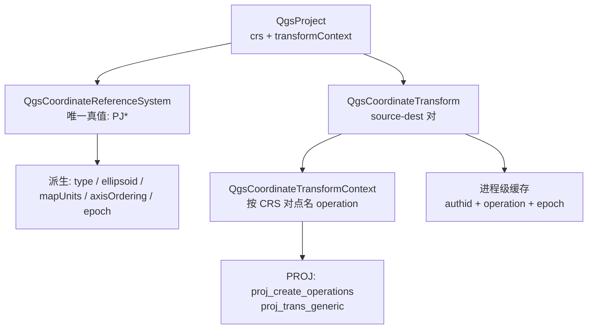

# QGIS 3.44 坐标参考系与投影：源码研读与 MBDSDR 对照

> 只读研读。本文不改动 MBDSDR 任何代码、配置或测试。
>
> 源码：`D:\mbdsdr\QGIS-final-3_44_15.tar.gz`，解包到仓库外
> `C:\Users\xxhzb\AppData\Local\Temp\qgis344\QGIS-final-3_44_15`
> （下文 `QGIS/` 均指该目录；所有 `path:line` 以这份解包为准）。
> 本项目指 `d:\mbdsdr\MBDSDR`。
>
> 文内链接为 `file:///` 绝对路径：QGIS 一侧指向上述临时解包目录
> （临时目录清理后会失效，行号仍可按同一 tarball 复核）；项目一侧指向
> `d:\mbdsdr\MBDSDR` 当前文件。
>
> 结论来源：源码阅读 + 一个临时公式复刻脚本（`%TEMP%\crs_probe.py`，
> 不 import 仓库代码）。**未编译、未运行 QGIS**；文中“实测”只证明公式级差异，
> 不等于某个面板运行时实际显示的差异，若要当缺陷证据必须在真实链路上复测。

---

## 0. 一句话结论

QGIS 的坐标栈只有一个真值：一个 `PJ*`（PROJ 对象）加一个“项目级变换上下文”。
CRS 的椭球、单位、轴序、类型、有效性全部从它派生；变换操作按 CRS 对在上下文里
点名一次，创建时枚举候选、按精度与可用网格选出唯一一条，并把结果放进程级缓存。
于是“同一个点算两次”在架构上没有第二个入口。

本项目没有 CRS 对象，也没有变换管线；坐标口径靠**常量 + 函数名后缀 + import 关系**
维持。核心 LLA/ECEF/ENU 已收敛到 `mbdsdr_ai/geodesy.py`，但地球模型（WGS-84 / WGS-72 /
6371 km 球）、GMST 公式、GEO 指向链仍各有分叉。缺的不是 PROJ，而是
**口径登记 + 唯一入口 + 常态对拍**。

---

## 1. QGIS 的坐标栈长什么样



对应源码：
- 项目唯一来源：[qgsproject.h:113-114](file:///C:/Users/xxhzb/AppData/Local/Temp/qgis344/QGIS-final-3_44_15/src/core/project/qgsproject.h#L113-L114)（`crs` 与 `transformContext` 两个属性）、[qgsproject.h:385](file:///C:/Users/xxhzb/AppData/Local/Temp/qgis344/QGIS-final-3_44_15/src/core/project/qgsproject.h#L385)、[:421](file:///C:/Users/xxhzb/AppData/Local/Temp/qgis344/QGIS-final-3_44_15/src/core/project/qgsproject.h#L421)、[:490](file:///C:/Users/xxhzb/AppData/Local/Temp/qgis344/QGIS-final-3_44_15/src/core/project/qgsproject.h#L490)。
- CRS 对象：[qgscoordinatereferencesystem.h:211](file:///C:/Users/xxhzb/AppData/Local/Temp/qgis344/QGIS-final-3_44_15/src/core/proj/qgscoordinatereferencesystem.h#L211)。
- 变换对象：[qgscoordinatetransform.cpp:62-93](file:///C:/Users/xxhzb/AppData/Local/Temp/qgis344/QGIS-final-3_44_15/src/core/proj/qgscoordinatetransform.cpp#L62-L93)。
- 上下文：[qgscoordinatetransformcontext.cpp:146-163](file:///C:/Users/xxhzb/AppData/Local/Temp/qgis344/QGIS-final-3_44_15/src/core/proj/qgscoordinatetransformcontext.cpp#L146-L163)。

下面按题目要求的六块逐条拆。

---

## 2. 条目一：CRS 怎么表达

### 2.1 QGIS 的做法

1. **对外允许多种写法，对内只有一个对象。**
   字符串入口 `createFromString()` 把 `EPSG:xxxx`、`WKT:...`、`PROJ:...`、
   `INTERNAL:<srsid>` 分派到不同构造器：权威码走 `createFromOgcWmsCrs`，
   `postgis:` / `internal:` 走旧的 srsid 入口，`proj4:`/`proj:` 走 proj 串，
   其余按 WKT 解析；并且**按原字符串缓存解析结果**，同一个串只会解析一次
   （[qgscoordinatereferencesystem.cpp:320-395](file:///C:/Users/xxhzb/AppData/Local/Temp/qgis344/QGIS-final-3_44_15/src/core/proj/qgscoordinatereferencesystem.cpp#L320-L395)、
   [qgscoordinatereferencesystem.h:550](file:///C:/Users/xxhzb/AppData/Local/Temp/qgis344/QGIS-final-3_44_15/src/core/proj/qgscoordinatereferencesystem.h#L550)）。
   典型入口：
   - 权威码：[`createFromOgcWmsCrs()` cpp:436](file:///C:/Users/xxhzb/AppData/Local/Temp/qgis344/QGIS-final-3_44_15/src/core/proj/qgscoordinatereferencesystem.cpp#L436)
   - WKT：[`createFromWktInternal()` cpp:962](file:///C:/Users/xxhzb/AppData/Local/Temp/qgis344/QGIS-final-3_44_15/src/core/proj/qgscoordinatereferencesystem.cpp#L962)
   - proj 串：[`createFromProj()` cpp:1045](file:///C:/Users/xxhzb/AppData/Local/Temp/qgis344/QGIS-final-3_44_15/src/core/proj/qgscoordinatereferencesystem.cpp#L1045)
   - 已有 PJ 对象：[`createFromProjObject()` cpp:3285](file:///C:/Users/xxhzb/AppData/Local/Temp/qgis344/QGIS-final-3_44_15/src/core/proj/qgscoordinatereferencesystem.cpp#L3285)

2. **有效性由 PROJ 判定，不自研解析。**
   `setProjString()` 先补 `+type=crs` 再 `proj_create`，失败即
   `mIsValid = false`（[cpp:1690-1721](file:///C:/Users/xxhzb/AppData/Local/Temp/qgis344/QGIS-final-3_44_15/src/core/proj/qgscoordinatereferencesystem.cpp#L1690-L1721)）；
   `setWktString()` 用 `proj_create_from_wkt` 并回收 warnings / grammarErrors
   （[cpp:1723-1761](file:///C:/Users/xxhzb/AppData/Local/Temp/qgis344/QGIS-final-3_44_15/src/core/proj/qgscoordinatereferencesystem.cpp#L1723-L1761)）。

3. **权威码查询有缓存、有旧名映射、有别名兜底。**
   `createFromOgcWmsCrs()`：先查 `sOgcCache`（cpp:441-451），解析 authority/code
   （cpp:454-476），再查旧 authid 映射表（cpp:478-495），再查 srs 数据库
   （cpp:497-503），最后处理 `CRS:27` 这类历史别名（cpp:505-511）。

4. **输出可序列化、可比较。**
   `toWkt()`（[cpp:2077](file:///C:/Users/xxhzb/AppData/Local/Temp/qgis344/QGIS-final-3_44_15/src/core/proj/qgscoordinatereferencesystem.cpp#L2077)）、
   `toProj()`（[cpp:1351-1365](file:///C:/Users/xxhzb/AppData/Local/Temp/qgis344/QGIS-final-3_44_15/src/core/proj/qgscoordinatereferencesystem.cpp#L1351-L1365)）；
   WKT 变体是显式枚举（`Qgis::CrsWktVariant`，[qgis.h:2382](file:///C:/Users/xxhzb/AppData/Local/Temp/qgis344/QGIS-final-3_44_15/src/core/qgis.h#L2382)）。
   类型也是显式枚举 `Qgis::CrsType`（地理/地心/投影/复合/动态…，
   [qgis.h:2277-2292](file:///C:/Users/xxhzb/AppData/Local/Temp/qgis344/QGIS-final-3_44_15/src/core/qgis.h#L2277-L2292)）。

5. **动态 CRS 带坐标历元。**
   `isDynamic()`（[cpp:1443-1450](file:///C:/Users/xxhzb/AppData/Local/Temp/qgis344/QGIS-final-3_44_15/src/core/proj/qgscoordinatereferencesystem.cpp#L1443-L1450)）、
   `coordinateEpoch()` / `setCoordinateEpoch()`
   （[cpp:1463-1478](file:///C:/Users/xxhzb/AppData/Local/Temp/qgis344/QGIS-final-3_44_15/src/core/proj/qgscoordinatereferencesystem.cpp#L1463-L1478)）。

### 2.2 本项目现状与差距

- 没有 CRS 对象。唯一相近的是 `geodesy.Ellipsoid`
  （[geodesy.py:57](file:///d:/mbdsdr/MBDSDR/mbdsdr_ai/geodesy.py#L57)），只有
  `name / a / f / e2`，不含单位、轴序、基准面、参考框架、历元。
- 坐标“契约”写在模块注释里：两套椭球不许统一
  （[geodesy.py:45-48](file:///d:/mbdsdr/MBDSDR/mbdsdr_ai/geodesy.py#L45-L48)）；
  返回顺序统一 `(lat_deg, lon_deg, alt)`
  （[geodesy.py:50](file:///d:/mbdsdr/MBDSDR/mbdsdr_ai/geodesy.py#L50)）；
  单位靠函数名后缀 `_m` / `_km` 钉死
  （[geodesy.py:51-52](file:///d:/mbdsdr/MBDSDR/mbdsdr_ai/geodesy.py#L51-L52)）。
- 站址的“CRS 规格”实际落在配置 schema：纬度 `[-90, 90]`、经度 `[-180, 180]`、
  “东经为正”、缺一即不计算
  （[config_schema.py:462-474](file:///d:/mbdsdr/MBDSDR/desktop/config_schema.py#L462-L474)）。
- 代码层检索不到 `pyproj` / `EPSG:` 的使用（只在文档里出现），也没有 WKT/proj 串。
- 差距不在“少一个类”，而在：**口径不可自描述**。任何函数只拿到 `float lat, lon, alt`，
  无法断言它属于哪套椭球、什么单位、什么轴序；只能靠调用方“记得”。

### 2.3 能不能加

能加，但只加**轻量口径对象**，不加 PROJ/WKT：

```
CrsSpec(name, ellipsoid, frame, unit, axis_order, epoch)
```

用它替换散落的 `Ellipsoid` 传参，让 `geodesy` 的入口签名从
`(lat, lon, alt, ellipsoid)` 变成 `(coords, crs_spec)`。这是纯 Python 数据类，
无新依赖。

### 2.4 不加完整 CRS 的理由

- 产品只服务地球、单站址、不导入用户矢量数据，不存在“任意 CRS 对”。
  完整 CRS 表达（WKT 变体、authority 查询、复合 CRS、动态 CRS）是纯成本。
- 但“不加完整 CRS”不等于“继续靠后缀字符串”。后缀方案在我们仓库能用，
  是因为调用面小、且有测试钉住；一旦接入外部数据（GeoJSON、KML、ADS-B 坐标）
  就会立刻失效。故建议只补 2.3 的轻量对象。

---

## 3. 条目二：基准面与椭球怎么绑定

### 3.1 QGIS 的做法

1. **椭球不是独立配置，而是 CRS 的派生量。**
   `ellipsoidAcronym()` 从 `PJ` 上取椭球，优先返回权威码 `AUTH:CODE`，
   没有权威码才退化为 `PARAMETER:<a>:<b>`
   （[cpp:1309-1344](file:///C:/Users/xxhzb/AppData/Local/Temp/qgis344/QGIS-final-3_44_15/src/core/proj/qgscoordinatereferencesystem.cpp#L1309-L1344)）。

2. **旧名/别名统一映射到权威码。**
   `ellipsoidParameters()` 内置映射表，例如 `WGS84 → EPSG:7030`、
   `IGNF:ELG053 → EPSG:7030`
   （[qgsellipsoidutils.cpp:41](file:///C:/Users/xxhzb/AppData/Local/Temp/qgis344/QGIS-final-3_44_15/src/core/proj/qgsellipsoidutils.cpp#L41)、
   [:116](file:///C:/Users/xxhzb/AppData/Local/Temp/qgis344/QGIS-final-3_44_15/src/core/proj/qgsellipsoidutils.cpp#L116)、
   [:143](file:///C:/Users/xxhzb/AppData/Local/Temp/qgis344/QGIS-final-3_44_15/src/core/proj/qgsellipsoidutils.cpp#L143)）；
   也支持 `PARAMETER:<a>:<b>` 自定义椭球
   （[:202-215](file:///C:/Users/xxhzb/AppData/Local/Temp/qgis344/QGIS-final-3_44_15/src/core/proj/qgsellipsoidutils.cpp#L202-L215)）。

3. **“只有椭球、没有基准面”必须显式告警，不许假装是高精度。**
   `createGeocentricCrs()` 调 `proj_create_geocentric_crs` 时
   `datum_name = nullptr`
   （[cpp:270-291](file:///C:/Users/xxhzb/AppData/Local/Temp/qgis344/QGIS-final-3_44_15/src/core/proj/qgscoordinatereferencesystem.cpp#L270-L291)），
   头文件明确写：这样得到的 CRS 不含基准面，任何涉及它的变换都会退化成
   ballpark（零）基准面平移，**不得用于高精度场景**
   （[qgscoordinatereferencesystem.h:378-393](file:///C:/Users/xxhzb/AppData/Local/Temp/qgis344/QGIS-final-3_44_15/src/core/proj/qgscoordinatereferencesystem.h#L378-L393)）。

4. **基准面集合（datum ensemble）单独建模。**
   `datumEnsemble()` 返回名称/权威码/精度信息
   （[cpp:1480-1498](file:///C:/Users/xxhzb/AppData/Local/Temp/qgis344/QGIS-final-3_44_15/src/core/proj/qgscoordinatereferencesystem.cpp#L1480-L1498)）。

### 3.2 本项目现状与差距

- 我们故意保留两套椭球（这是对的）：
  - WGS-84：`a=6378137, f=1/298.257223563`，RTK/GNSS 口径
    （[geodesy.py:36-39](file:///d:/mbdsdr/MBDSDR/mbdsdr_ai/geodesy.py#L36-L39)、
    [:74](file:///d:/mbdsdr/MBDSDR/mbdsdr_ai/geodesy.py#L74)）；
  - WGS-72：`a=6378135, f=1/298.26`，SGP4/TEME 口径
    （[geodesy.py:76](file:///d:/mbdsdr/MBDSDR/mbdsdr_ai/geodesy.py#L76)）。
  - 测试把 2.0 m 赤道半径差写成硬断言
    （[test_geodesy_ecef_lla.py:47-54](file:///d:/mbdsdr/MBDSDR/tests/test_geodesy_ecef_lla.py#L47-L54)）。
- **但 WGS-72 常量在 `orbit.py` 里又写了一份**
  （[orbit.py:56-60](file:///d:/mbdsdr/MBDSDR/mbdsdr_ai/orbit.py#L56-L60)），
  与 `geodesy.WGS72` 数值相同但是两个真值源。
- **第三条地球模型：6371 km 正球**，用于 GEO 指向
  （[acquisition.py:41-44](file:///d:/mbdsdr/MBDSDR/mbdsdr_ai/acquisition.py#L41-L44)、
  [:373-376](file:///d:/mbdsdr/MBDSDR/mbdsdr_ai/acquisition.py#L373-L376)）。
- 没有基准面概念：所有 WGS-72 链默认“同一基准面”，没有 WGS-84↔WGS-72 的
  七参数/网格变换，也没有“允许 ballpark”的显式开关。
- 差距：QGIS 至少强制“有椭球必须有基准面，或者明确告警只做 ballpark”；
  我们连“这条链用的是哪套模型”都没有可断言的地方，球/椭球混用不会报错。

**实测口径差异（同一 GEO 目标，站 39.9N/116.4E/50 m，星下点 105E、h=35786 km）：**

| 模型 | azimuth | elevation | slant range |
|---|---|---|---|
| 正球 6371 km（acquisition 口径） | 197.450189° | 42.354254° | 37601.010683 km |
| WGS-72 椭球（orbit 口径） | 197.463206° | 42.377941° | 37594.386848 km |
| 差 | −0.013017° | −0.023687° | +6.623835 km |

取数方式：`%TEMP%\crs_probe.py` 复刻两条链的公式（正球 ECEF、WGS-72 大地→ECEF、
同一 ENU 旋转），输入如上；**未调用仓库函数**，所以这是“公式会差多少”，
不是“面板一定显示差多少”。

### 3.3 能不能加

能，且成本极低：
1. 删除 `orbit.py` 里重复的 WGS-72 常量，统一 import `geodesy.WGS72`（纯等价替换）。
2. GEO 指向要么改走 `orbit` 的椭球链，要么在结果里显式标注
   `earth_model="sphere_6371"` 并限定用途（链路预算可接受，指向精度不可）。

### 3.4 不加 datum 变换的理由

- 我们没有跨基准面的坐标输入：站址是用户手填 WGS-84 经纬度，卫星是 SGP4/TEME，
  两者都在“地球固连、WGS 系”内。没有第三方基准面数据，做七参数/网格变换是空转。
- 但“球 vs 椭球”不是基准面问题，是**同一场景下的口径分叉**，必须消掉。

---

## 4. 条目三：坐标变换管线怎么组织

### 4.1 QGIS 的做法

三层，职责分明：

**第一层：项目上下文只回答“用哪条操作”。**
`calculateCoordinateOperation(source, destination)` 以 CRS 对为键，
查不到再反向查（[qgscoordinatetransformcontext.cpp:146-163](file:///C:/Users/xxhzb/AppData/Local/Temp/qgis344/QGIS-final-3_44_15/src/core/proj/qgscoordinatetransformcontext.cpp#L146-L163)）；
`allowFallbackTransform()`（[:165-179](file:///C:/Users/xxhzb/AppData/Local/Temp/qgis344/QGIS-final-3_44_15/src/core/proj/qgscoordinatetransformcontext.cpp#L165-L179)）
与 `mustReverseCoordinateOperation()`（[:181-202](file:///C:/Users/xxhzb/AppData/Local/Temp/qgis344/QGIS-final-3_44_15/src/core/proj/qgscoordinatetransformcontext.cpp#L181-L202)）
是同一条记录的附属语义。键做了归一化（`crsToKey`，[:23](file:///C:/Users/xxhzb/AppData/Local/Temp/qgis344/QGIS-final-3_44_15/src/core/proj/qgscoordinatetransformcontext.cpp#L23)），
所以 `EPSG:4326` 与等价 WKT 不会变成两条操作。

**第二层：变换对象在创建时就把管线定死。**
`calculateTransforms()` 先从上下文取三件事：操作串、是否反向、是否允许回退
（[qgscoordinatetransform_p.cpp:233-248](file:///C:/Users/xxhzb/AppData/Local/Temp/qgis344/QGIS-final-3_44_15/src/core/proj/qgscoordinatetransform_p.cpp#L233-L248)）。
随后：
- 有项目指定操作 → 直接 `proj_create`；若创建失败，或（仅当 PROJ 网络启用时）
  `proj_coordoperation_is_instantiable` 判定缺网格 → 通知 handler 或记 Critical，
  然后**丢弃该操作**
  （[:272-310](file:///C:/Users/xxhzb/AppData/Local/Temp/qgis344/QGIS-final-3_44_15/src/core/proj/qgscoordinatetransform_p.cpp#L272-L310)）。
- 没有 → 用 `proj_create_operations` 枚举候选
  （[:320-344](file:///C:/Users/xxhzb/AppData/Local/Temp/qgis344/QGIS-final-3_44_15/src/core/proj/qgscoordinatetransform_p.cpp#L320-L344)）：
  - 只有 1 条：能用就用，缺网格则报 `missing required grid`
    （[:345-389](file:///C:/Users/xxhzb/AppData/Local/Temp/qgis344/QGIS-final-3_44_15/src/core/proj/qgscoordinatetransform_p.cpp#L345-L389)）；
  - 多条：按顺序找“可实例化”的第一条，同时记住被跳过的高精度首选；
    用了次选要显式告警“非首选操作”
    （[:404-449](file:///C:/Users/xxhzb/AppData/Local/Temp/qgis344/QGIS-final-3_44_15/src/core/proj/qgscoordinatetransform_p.cpp#L404-L449)）。
- 无论哪条路径，**最后一律 `proj_normalize_for_visualization`**，
  把轴序统一成 QGIS 的 x/y
  （[:393-401](file:///C:/Users/xxhzb/AppData/Local/Temp/qgis344/QGIS-final-3_44_15/src/core/proj/qgscoordinatetransform_p.cpp#L393-L401)、
  [:451-459](file:///C:/Users/xxhzb/AppData/Local/Temp/qgis344/QGIS-final-3_44_15/src/core/proj/qgscoordinatetransform_p.cpp#L451-L459)）。
  注释写得很直白：*“For QGIS, we ALWAYS need regular x/y axis order”*。

**第三层：按线程缓存 PJ 句柄。**
`threadLocalProjData()` 以 `PJ_CONTEXT*` 为键缓存
（[:250-262](file:///C:/Users/xxhzb/AppData/Local/Temp/qgis344/QGIS-final-3_44_15/src/core/proj/qgscoordinatetransform_p.cpp#L250-L262)、
[:511-513](file:///C:/Users/xxhzb/AppData/Local/Temp/qgis344/QGIS-final-3_44_15/src/core/proj/qgscoordinatetransform_p.cpp#L511-L513)）；
失败回退用另一张表 `threadLocalFallbackProjData()`（[:516-538](file:///C:/Users/xxhzb/AppData/Local/Temp/qgis344/QGIS-final-3_44_15/src/core/proj/qgscoordinatetransform_p.cpp#L516-L538)）。

**对象级缓存**在 `QgsCoordinateTransform`：
`setFromCache()` 的匹配键是 `(源键, 目标键)` + 操作串 + `allowFallback` + 两端历元
（[qgscoordinatetransform.cpp:1177-1220](file:///C:/Users/xxhzb/AppData/Local/Temp/qgis344/QGIS-final-3_44_15/src/core/proj/qgscoordinatetransform.cpp#L1177-L1220)）；
`addToCache()` 写回（[:1222-1240](file:///C:/Users/xxhzb/AppData/Local/Temp/qgis344/QGIS-final-3_44_15/src/core/proj/qgscoordinatetransform.cpp#L1222-L1240)）；
`invalidateCache()` 可整体清空（[:1272-1284](file:///C:/Users/xxhzb/AppData/Local/Temp/qgis344/QGIS-final-3_44_15/src/core/proj/qgscoordinatetransform.cpp#L1272-L1284)）。

**一个容易被忽略的设计：拷贝不继承“许可开关”。**
拷贝构造函数明确不复制 `mIgnoreImpossible`、`mBallparkTransformsAreAppropriate`、
`mDisableFallbackHandler`，注释说明理由：否则会把“某个调用方的宽松许可”
污染到缓存和其它对象上
（[qgscoordinatetransform.cpp:147-162](file:///C:/Users/xxhzb/AppData/Local/Temp/qgis344/QGIS-final-3_44_15/src/core/proj/qgscoordinatetransform.cpp#L147-L162)）。

### 4.2 本项目现状与差距

- 没有“管线”这一层，也没有“操作选择”：
  调用方直接拼函数。典型链：
  `Satrec → TEME → ECEF → LLH/GMST → ENU → az/el`
  （[orbit.py:398](file:///d:/mbdsdr/MBDSDR/mbdsdr_ai/orbit.py#L398)、
  [:233](file:///d:/mbdsdr/MBDSDR/mbdsdr_ai/orbit.py#L233)）。
- 已经收敛的部分（这是既有资产，应保留）：
  - `decoders` 不再内联几何，统一走 `orbit.satellite_raw_state`
    （[decoders.py:167-171](file:///d:/mbdsdr/MBDSDR/mbdsdr_ai/decoders.py#L167-L171)）；
  - 星下点统一走 `wgs72_ecef_km_to_llh`，并留了旧球反解差异的记录
    （[decoders.py:240-242](file:///d:/mbdsdr/MBDSDR/mbdsdr_ai/decoders.py#L240-L242)）；
  - 地面轨迹走 `orbit` 的同一内核
    （[ground_track.py:95-96](file:///d:/mbdsdr/MBDSDR/mbdsdr_ai/ground_track.py#L95-L96)）；
  - `geodesy` 是 LLA/ECEF/ENU 的唯一底层
    （[geodesy.py:4-10](file:///d:/mbdsdr/MBDSDR/mbdsdr_ai/geodesy.py#L4-L10)、
    [:42-52](file:///d:/mbdsdr/MBDSDR/mbdsdr_ai/geodesy.py#L42-L52)）。
- 仍然并行的链：
  - `astronomy._sat_elaz_at_unix` 内联复制了整套 ECEF/GMST/ENU
    （[astronomy.py:620-669](file:///d:/mbdsdr/MBDSDR/mbdsdr_ai/astronomy.py#L620-L669)）；
  - `orbit_determination` 有自己的 GMST 与 ECI↔ECEF、ENU 轴
    （[orbit_determination.py:64-72](file:///d:/mbdsdr/MBDSDR/mbdsdr_ai/orbit_determination.py#L64-L72)、
    [:115](file:///d:/mbdsdr/MBDSDR/mbdsdr_ai/orbit_determination.py#L115)、
    [:128](file:///d:/mbdsdr/MBDSDR/mbdsdr_ai/orbit_determination.py#L128)）；
  - `acquisition` 的球模型 GEO 指向（见 3.2）；
  - skyfield 链：过境/天空视图/卫星跟踪
    （`sat_passes.py`、`sat_tracker.py`、`sat_illumination.py`）。
- 对拍守卫存在但没接线：`sat_consistency.py` 定义了“三路径 az/el 一致性”，
  默认容差 0.5°，只比 az/el 不比 range
  （[sat_consistency.py:11](file:///d:/mbdsdr/MBDSDR/mbdsdr_ai/sat_consistency.py#L11)、
  [:30](file:///d:/mbdsdr/MBDSDR/mbdsdr_ai/sat_consistency.py#L30)、
  [:61-139](file:///d:/mbdsdr/MBDSDR/mbdsdr_ai/sat_consistency.py#L61-L139)），
  但全仓只有它自己的测试引用，**没有任何生产调用方**。

### 4.3 能不能加

能加“上下文”，不加 PROJ 管线：

- 一个不可变 `TransformContext`：`{time_source, tle_epoch, earth_model, frame,
  unit, axis_order, tolerance}`，由调用方显式传入，几何入口只接受它。
- 一个 `geodesy.lla_ecef(frame_origin, target_frame)` 式的**唯一出口**，
  所有现有入口（orbit / astronomy / acquisition / orbit_determination）改为调用它。
- 把 `sat_consistency` 接进真实路径（过境列表 / 天空视图 / 多普勒），
  超差时在 UI 上显示，而不是只存在于测试里。

### 4.4 不加 PROJ 管线的理由

- 我们只有固定几条有向链，没有“任意 CRS 对”，`proj_create_operations`
  的候选枚举、网格可用性、按精度排序全部用不上。
- 引入 PROJ/pyproj 会带来新依赖、新数据包（proj.db）、打包体积与离线部署问题，
  收益却只是替我们做“本来只有一条路”的选择。

---

## 5. 条目四：什么情况下拒绝变换

### 5.1 QGIS 的做法（逐类）

| 场景 | 行为 | 证据 |
|---|---|---|
| CRS 无效 | 变换对象置为 invalid + short-circuit；`transform()` 原样返回输入，并记 CRS 日志 | [`qgscoordinatetransform_p.cpp:116-131`](file:///C:/Users/xxhzb/AppData/Local/Temp/qgis344/QGIS-final-3_44_15/src/core/proj/qgscoordinatetransform_p.cpp#L116-L131)、[`qgscoordinatetransform.cpp:913-930`](file:///C:/Users/xxhzb/AppData/Local/Temp/qgis344/QGIS-final-3_44_15/src/core/proj/qgscoordinatetransform.cpp#L913-L930) |
| 源=目标 | 同样 short-circuit，不算错误 | [`_p.cpp:156-161`](file:///C:/Users/xxhzb/AppData/Local/Temp/qgis344/QGIS-final-3_44_15/src/core/proj/qgscoordinatetransform_p.cpp#L156-L161) |
| 天体不同（地球↔月球） | `isTransformationPossible()` 返回 false；仅在 `IgnoreImpossibleTransformations` 时静默置无效 | [`transform.cpp:191-200`](file:///C:/Users/xxhzb/AppData/Local/Temp/qgis344/QGIS-final-3_44_15/src/core/proj/qgscoordinatetransform.cpp#L191-L200)、[:74-78](file:///C:/Users/xxhzb/AppData/Local/Temp/qgis344/QGIS-final-3_44_15/src/core/proj/qgscoordinatetransform.cpp#L74-L78) |
| 没有可用操作 | 通知 `sCoordinateOperationCreationErrorHandler` 或记 Critical；返回 `nullptr` → 对象无效 | [`_p.cpp:466-509`](file:///C:/Users/xxhzb/AppData/Local/Temp/qgis344/QGIS-final-3_44_15/src/core/proj/qgscoordinatetransform_p.cpp#L466-L509) |
| 缺必需网格 | 报 `missing required grid`（含网格名、下载 URL、许可证信息） | [`_p.cpp:354-388`](file:///C:/Users/xxhzb/AppData/Local/Temp/qgis344/QGIS-final-3_44_15/src/core/proj/qgscoordinatetransform_p.cpp#L354-L388) |
| 有次选、缺首选 | 用次选，但明确告警“Using non-preferred coordinate operation” | [`_p.cpp:433-449`](file:///C:/Users/xxhzb/AppData/Local/Temp/qgis344/QGIS-final-3_44_15/src/core/proj/qgscoordinatetransform_p.cpp#L433-L449) |
| 运行时变换失败 | 检查 `proj_errno`，并额外扫描 inf（`proj_errno` 不可靠）；仍失败则抛 `QgsCsException` | [`transform.cpp:994-1004`](file:///C:/Users/xxhzb/AppData/Local/Temp/qgis344/QGIS-final-3_44_15/src/core/proj/qgscoordinatetransform.cpp#L994-L1004)、[:1096](file:///C:/Users/xxhzb/AppData/Local/Temp/qgis344/QGIS-final-3_44_15/src/core/proj/qgscoordinatetransform.cpp#L1096) |
| 2D 包围盒遇到地心 CRS | 直接抛异常（地心 CRS 下 2D bbox 无意义） | [`transform.cpp:602-610`](file:///C:/Users/xxhzb/AppData/Local/Temp/qgis344/QGIS-final-3_44_15/src/core/proj/qgscoordinatetransform.cpp#L602-L610) |
| 失败后的回退 | 只在“存在多条候选操作且允许回退/球面近似”时才尝试；否则不掩盖失败 | [`transform.cpp:1006-1013`](file:///C:/Users/xxhzb/AppData/Local/Temp/qgis344/QGIS-final-3_44_15/src/core/proj/qgscoordinatetransform.cpp#L1006-L1013) |

要点：QGIS 的“拒绝”分两种强度——**对象级无效（静默直通 + 日志）** 与
**运行时异常（调用方必须处理）**；绝不返回一个“看起来正常但错的值”。

### 5.2 本项目现状与差距

- **没有拒绝点。**
  - 没有 CRS 合法性概念，因此不存在“拒绝变换”。
  - 混用椭球/球不会报错（3.2 的 6.62 km 距离差就是静默产生的）。
  - TLE 不可用时 `decoders` 返回 `None`，这一点是诚实的
    （[decoders.py:173-174](file:///d:/mbdsdr/MBDSDR/mbdsdr_ai/decoders.py#L173-L174)），
    但属于“输入缺失”，不是“坐标口径不可信”。
- **公式级降级不显式。** 同一时刻存在三套 GMST：
  - `atmosphere._gmst_deg`：IAU 1982 直接式
    （[atmosphere.py:107-112](file:///d:/mbdsdr/MBDSDR/mbdsdr_ai/atmosphere.py#L107-L112)）；
  - `astronomy.jd_to_gmst`：注释写“IAU 2006 近似”，但多项式其实就是 IAU 1982
    （[astronomy.py:318-323](file:///d:/mbdsdr/MBDSDR/mbdsdr_ai/astronomy.py#L318-L323)）；
  - `celestial_geometry.gmst`：Capitaine 2003
    （[celestial_geometry.py:199-201](file:///d:/mbdsdr/MBDSDR/mbdsdr_ai/celestial_geometry.py#L199-L201)）；
  - `orbit_determination.gmst_rad`：IAU 1982 的秒制形式
    （[orbit_determination.py:64-72](file:///d:/mbdsdr/MBDSDR/mbdsdr_ai/orbit_determination.py#L64-L72)）。

  **实测（JD 2461358.5，2026-11-14 00:00 UTC）：**

  | 对比 | 差值 |
  |---|---|
  | atmosphere(IAU1982) − orbit(同式秒制) | 0.000111″ |
  | atmosphere(IAU1982) − celestial(Capitaine 2003) | 0.060070″ |
  | orbit(秒制) − celestial(Capitaine 2003) | 0.059959″ |

  0.060″ 在赤道约 1.86 m，等效约 4.0 ms 的地球自转。取数同上（`%TEMP%\crs_probe.py`，
  JD 固定、公式复刻）。

- **skyfield 与 sgp4 两条链的差异被 0.5° 容差“吸收”**，而 0.5° 远大于上述
  任何一项系统差；`sat_consistency` 也不比 range，所以“距离差 6.6 km”这类
  问题它看不见（[sat_consistency.py:30](file:///d:/mbdsdr/MBDSDR/mbdsdr_ai/sat_consistency.py#L30)、
  [:61-139](file:///d:/mbdsdr/MBDSDR/mbdsdr_ai/sat_consistency.py#L61-L139)）。

### 5.3 能不能加

能，三个低成本拒绝点：

1. **入口契约校验**：`lat ∈ [-90,90]`、`lon ∈ [-180,180]`、单位后缀与函数匹配、
   `ellipsoid` 与场景匹配（SGP4 只接受 WGS-72，RTK 只接受 WGS-84）。
   违反就抛 `ValueError`，不要静默换算。
2. **场景级模型白名单**：GEO 指向若仍用球模型，返回结构里带
   `earth_model` 字段，UI 文案明确“链路预算口径，非指向精度”。
3. **对拍守卫接线**：`sat_consistency` 进真实路径；超差时显示 delta，
   并把 `range` 纳入比较（比 az/el 更敏感）。

### 5.4 不加“操作不可实例化”语义的理由

- 我们没有可插拔的基准面/网格库，不存在“操作存在但缺网格”的状态。
  强行模拟只会造出一个永远不会触发的分支。

---

## 6. 条目五：单位与轴序怎么处理

### 6.1 QGIS 的做法

1. **单位是派生量，不是配置项。**
   `mapUnits()`（[cpp:1588](file:///C:/Users/xxhzb/AppData/Local/Temp/qgis344/QGIS-final-3_44_15/src/core/proj/qgscoordinatereferencesystem.cpp#L1588)）
   返回 `Qgis::DistanceUnit`；`setMapUnits()` 从 PROJ 坐标轴信息里读第一个轴的
   单位名，再映射到枚举（[cpp:1798-1863](file:///C:/Users/xxhzb/AppData/Local/Temp/qgis344/QGIS-final-3_44_15/src/core/proj/qgscoordinatereferencesystem.cpp#L1798-L1863)）。
   失败一律 `Unknown`，不猜（[:1800-1810](file:///C:/Users/xxhzb/AppData/Local/Temp/qgis344/QGIS-final-3_44_15/src/core/proj/qgscoordinatereferencesystem.cpp#L1800-L1810)）。
   单位枚举覆盖度/英尺/链/杆等
   （[qgis.h:4916](file:///C:/Users/xxhzb/AppData/Local/Temp/qgis344/QGIS-final-3_44_15/src/core/qgis.h#L4916)）。

2. **轴序是 CRS 的属性，且可枚举方向。**
   `axisOrdering()` 返回 `QList<Qgis::CrsAxisDirection>`
   （[cpp:859](file:///C:/Users/xxhzb/AppData/Local/Temp/qgis344/QGIS-final-3_44_15/src/core/proj/qgscoordinatereferencesystem.cpp#L859)、
   [h:893](file:///C:/Users/xxhzb/AppData/Local/Temp/qgis344/QGIS-final-3_44_15/src/core/proj/qgscoordinatereferencesystem.h#L893)）；
   `hasAxisInverted()`（[cpp:848](file:///C:/Users/xxhzb/AppData/Local/Temp/qgis344/QGIS-final-3_44_15/src/core/proj/qgscoordinatereferencesystem.cpp#L848)）；
   方向枚举按 WKT 规范列全（北/东北/地心 X/Y/Z/上/下…，
   [qgis.h:2302-2344](file:///C:/Users/xxhzb/AppData/Local/Temp/qgis344/QGIS-final-3_44_15/src/core/qgis.h#L2302-L2344)）。

3. **展示层显式区分 XY / YX。**
   `Qgis::CoordinateOrder` 三态：Default / XY / YX
   （[qgis.h:2352-2358](file:///C:/Users/xxhzb/AppData/Local/Temp/qgis344/QGIS-final-3_44_15/src/core/qgis.h#L2352-L2358)）；
   `QgsCoordinateFormatter::format()`、`formatX()`、`formatY()`、`asPair()`
   都把它作为参数
   （[qgscoordinateformatter.h:75-109](file:///C:/Users/xxhzb/AppData/Local/Temp/qgis344/QGIS-final-3_44_15/src/core/qgscoordinateformatter.h#L75-L109)）。

4. **变换层强制归一化。**
   无论源/目标 CRS 声明什么轴序，创建管线后立刻
   `proj_normalize_for_visualization`，保证调用方永远给 x/y
   （[`_p.cpp:393-401`](file:///C:/Users/xxhzb/AppData/Local/Temp/qgis344/QGIS-final-3_44_15/src/core/proj/qgscoordinatetransform_p.cpp#L393-L401)、
   [:451-459](file:///C:/Users/xxhzb/AppData/Local/Temp/qgis344/QGIS-final-3_44_15/src/core/proj/qgscoordinatetransform_p.cpp#L451-L459)）。

### 6.2 本项目现状与差距

- 单位靠命名后缀 + 测试钉死：
  `_m` = 米、`_km` = 公里，不做隐式换算
  （[geodesy.py:51-52](file:///d:/mbdsdr/MBDSDR/mbdsdr_ai/geodesy.py#L51-L52)）；
  测试显式验证“米/公里不可互换”
  （[test_geodesy_ecef_lla.py:76-80](file:///d:/mbdsdr/MBDSDR/tests/test_geodesy_ecef_lla.py#L76-L80)）。
- 返回顺序 `(lat, lon, alt)` 是全仓约定
  （[geodesy.py:50](file:///d:/mbdsdr/MBDSDR/mbdsdr_ai/geodesy.py#L50)），
  测试锁死“第一项必须是纬度”
  （[test_geodesy_ecef_lla.py:61-64](file:///d:/mbdsdr/MBDSDR/tests/test_geodesy_ecef_lla.py#L61-L64)）。
- ENU 是显式函数，不靠轴序参数
  （[geodesy.py:166-205](file:///d:/mbdsdr/MBDSDR/mbdsdr_ai/geodesy.py#L166-L205)）。
- 地图显示是 Web Mercator，纬度夹到 ±85.05112878
  （[osm_map.py:66](file:///d:/mbdsdr/MBDSDR/desktop/osm_map.py#L66)、
  [:160-175](file:///d:/mbdsdr/MBDSDR/desktop/osm_map.py#L160-L175)）；
  这是对 Web Mercator 的正确处理，但代码里没有 `EPSG:3857` 这类标识。
- 死代码里还有第二份 Web Mercator（`new_spacetime.web_mercator_project`，
  [new_spacetime.py:757-766](file:///d:/mbdsdr/MBDSDR/mbdsdr_ai/new_spacetime.py#L757-L766)），
  与 `osm_map` 数学等价（`asinh(tan φ)` 即标准式），目前全仓无调用，
  已在冗余登记中判为“确认无用”。
- 没有任何统一坐标格式化入口；`new_spacetime.format_dms`
  （[:769](file:///d:/mbdsdr/MBDSDR/mbdsdr_ai/new_spacetime.py#L769)）同样无调用。

差距：QGIS 把“单位/轴序”变成类型系统的一部分；我们把它变成命名约定。
在本仓库可行，但**不能跨模块传递后仍然自证**。

### 6.3 能不能加

能，且建议只加两件：

1. `coords.py` 里加 `AxisOrder` 与 `Unit` 两个枚举，供 `geodesy` 入口签名使用；
   不引入多单位体系（只有 degree / m / km）。
2. 地图层把 `WEB_MERCATOR_MAX_LAT = 85.05112878` 与 `EPSG:3857` 语义写进常量名
   和注释，让“为什么夹这个纬度”可检索，而不是一个魔数。

### 6.4 不加 QGIS 级 axisOrder 的理由

- 我们不接收外部数据，轴序恒为 `(lat, lon)`；`CoordinateOrder` 机制服务的是
  “用户/数据源可能给 YX”的场景，这里不存在。
- 但“单位在名字里”比“单位在类型里”弱，这是既有测试在兜底的原因；
  保持现状可接受，前提是新增入口必须沿用后缀约定。

---

## 7. 条目六：怎么避免“同一个点算两次得两个答案”

### 7.1 QGIS 的七道闸

1. **唯一 CRS 真值**：一个 `PJ*`，椭球/单位/轴序/类型全部派生
   （§2、§3、§6 的证据）；同一 CRS 字符串还会命中解析缓存，
   不会因重复解析得到两个对象
   （[qgscoordinatereferencesystem.cpp:325-335](file:///C:/Users/xxhzb/AppData/Local/Temp/qgis344/QGIS-final-3_44_15/src/core/proj/qgscoordinatereferencesystem.cpp#L325-L335)）。
2. **唯一操作记录**：上下文按 CRS 对存 operation，支持反向查询与归一化键
   （[context.cpp:146-202](file:///C:/Users/xxhzb/AppData/Local/Temp/qgis344/QGIS-final-3_44_15/src/core/proj/qgscoordinatetransformcontext.cpp#L146-L202)、
   [:23](file:///C:/Users/xxhzb/AppData/Local/Temp/qgis344/QGIS-final-3_44_15/src/core/proj/qgscoordinatetransformcontext.cpp#L23)）。
3. **唯一创建路径 + 进程级缓存**：所有构造都走
   `calculateTransforms` → 缓存查找 → `initialize` → 写缓存
   （[transform.cpp:83-89](file:///C:/Users/xxhzb/AppData/Local/Temp/qgis344/QGIS-final-3_44_15/src/core/proj/qgscoordinatetransform.cpp#L83-L89)、
   [:1177-1240](file:///C:/Users/xxhzb/AppData/Local/Temp/qgis344/QGIS-final-3_44_15/src/core/proj/qgscoordinatetransform.cpp#L1177-L1240)）。
   缓存键含 operation / fallback / 历元，所以“不同许可”不会互相命中
   （[:1197-1201](file:///C:/Users/xxhzb/AppData/Local/Temp/qgis344/QGIS-final-3_44_15/src/core/proj/qgscoordinatetransform.cpp#L1197-L1201)）。
4. **拷贝不带走许可**：避免某个调用方的宽松设置污染共享缓存
   （[transform.cpp:147-162](file:///C:/Users/xxhzb/AppData/Local/Temp/qgis344/QGIS-final-3_44_15/src/core/proj/qgscoordinatetransform.cpp#L147-L162)）。
5. **轴序在创建时归一化一次**，运行时没有“这个调用方用 YX”的歧义
   （[`_p.cpp:393-401`](file:///C:/Users/xxhzb/AppData/Local/Temp/qgis344/QGIS-final-3_44_15/src/core/proj/qgscoordinatetransform_p.cpp#L393-L401)）。
6. **能算就一条、不能算就明确说**：候选选择、缺网格、非首选、运行时异常
   全部有显式分支（§5）。
7. **项目级单点**：`QgsProject::crs()` 与 `transformContext()` 是唯一来源，
   `crsChanged` 驱动重绘/重算（[qgsproject.h:113-114](file:///C:/Users/xxhzb/AppData/Local/Temp/qgis344/QGIS-final-3_44_15/src/core/project/qgsproject.h#L113-L114)、
   [:1952](file:///C:/Users/xxhzb/AppData/Local/Temp/qgis344/QGIS-final-3_44_15/src/core/project/qgsproject.h#L1952)）。

### 7.2 本项目现状：已收敛与仍分叉

**已收敛（应视为资产）：**

| 事实 | 唯一入口 | 证据 |
|---|---|---|
| LLA ↔ ECEF | `geodesy.geodetic_to_ecef_* / ecef_to_geodetic_*` | [geodesy.py:79-135](file:///d:/mbdsdr/MBDSDR/mbdsdr_ai/geodesy.py#L79-L135) |
| ECEF ↔ ENU / az-el | `geodesy.CoordinateConverter` | [geodesy.py:137-216](file:///d:/mbdsdr/MBDSDR/mbdsdr_ai/geodesy.py#L137-L216) |
| 卫星几何（面板/解码/多普勒） | `orbit.satellite_raw_state` | [decoders.py:167-171](file:///d:/mbdsdr/MBDSDR/mbdsdr_ai/decoders.py#L167-L171)、[orbit.py:398](file:///d:/mbdsdr/MBDSDR/mbdsdr_ai/orbit.py#L398) |
| 星下点 / 地面轨迹 | `orbit.wgs72_ecef_km_to_llh` | [ground_track.py:95-96](file:///d:/mbdsdr/MBDSDR/mbdsdr_ai/ground_track.py#L95-L96) |
| 升落预报 | `orbit._state_from_satrec`（无 TLE 不传播） | [skyengine/satellites.py:116-123](file:///d:/mbdsdr/MBDSDR/mbdsdr_ai/skyengine/satellites.py#L116-L123) |

**仍分叉（按影响排序）：**

| # | 事实 | 入口 A | 入口 B | 现状 |
|---|---|---|---|---|
| 1 | GEO 指向的 az/el/range | 球模型 [acquisition.py:373-399](file:///d:/mbdsdr/MBDSDR/mbdsdr_ai/acquisition.py#L373-L399) | 椭球 [orbit.py:398](file:///d:/mbdsdr/MBDSDR/mbdsdr_ai/orbit.py#L398) | 实测差 0.013°/0.024°/6.62 km，静默 |
| 2 | GMST | IAU1982 [atmosphere.py:107](file:///d:/mbdsdr/MBDSDR/mbdsdr_ai/atmosphere.py#L107) | Capitaine2003 [celestial_geometry.py:201](file:///d:/mbdsdr/MBDSDR/mbdsdr_ai/celestial_geometry.py#L201) | 实测差 0.060″（≈1.86 m） |
| 3 | 卫星 az/el 链 | skyfield（`sat_passes`/`sat_tracker`） | sgp4（`orbit`） | 对拍守卫存在但无生产调用；容差 0.5° 且不比 range |
| 4 | GMST 常量来源 | `orbit.py:60` 与 `orbit_determination.py:45` 各自定义 `OMEGA_E` | — | 数值同为 7.292115e-5，但两个真值源 |
| 5 | WGS-72 参数 | `geodesy.WGS72`（geodesy.py:76） | `orbit.WGS72_A/F/B/E2`（orbit.py:56-59） | 数值一致，重复定义 |
| 6 | 卫星星下点旧实现 | 已删（球反解） | 现行 `wgs72_ecef_km_to_llh` | 已收敛，差异 0.17°/13 km 有记录（decoders.py:240-242） |
| 7 | Web Mercator | `osm_map` | `new_spacetime`（死代码） | 无运行时风险，但要防“复活” |

**结论：** 我们的“两个答案”不是缺框架，而是缺三样东西：

1. **口径登记**：哪个场景用哪套椭球/时间尺度/单位，写在一处、可检索、可断言。
2. **唯一入口**：GMST、GEO 指向、WGS-72 常量各自收敛一次。
3. **常态对拍**：一致性守卫必须进入真实 UI 路径，并且比较 range 而不只是角度。

### 7.3 能不能加

能，且这是本文最推荐的一组改动（均为小改动、可反证）：

- **GMST 单内核**：保留 `orbit._gmst_days`（与 SGP4 同源），
  `atmosphere` / `astronomy` / `celestial_geometry` 全部 import 它；
  若要保留 Capitaine 2003，必须显式命名用途并在结果中标注模型。
- **GEO 指向统一**：`acquisition._geo_pointing` 改走 `orbit` 的椭球链；
  若确需球模型，返回结构加 `earth_model` 并限定用途。
- **对拍接线**：过境列表/天空视图/多普勒展示同一时刻的三路 az/el 与 range，
  超差显示 delta；`sat_consistency` 的容差按口径定（角度可 0.1°，
  range 用米级），而不是 0.5° 一刀切。
- **反证**：把 GMST 改回另一套公式 / 把 GEO 指向改回球模型，
  对应一致性测试必须变红；只改期望值不算修复。

### 7.4 不加 PROJ 级缓存/键机制的理由

- 我们不是“每帧对成千上万个要素做重投影”的 GIS，缓存没有收益。
  真正需要的是“同一事实只有一个入口”，这与缓存无关。
- 缓存还会掩盖分叉：如果两套实现都能命中，差异就永远没人看见。

---

## 8. 建议移植清单（只读建议，未实施）

按性价比排序，每条都可独立验收。

### P0：先止血（不改架构）

1. **删除重复的 WGS-72 常量**：`orbit.py:56-59` 改为 import `geodesy.WGS72`。
   验收：`tests/test_geodesy_ecef_lla.py` 全绿；`orbit` 的黄金向量逐一不变。
2. **GMST 收敛**：其余模块 import 同一个实现；`astronomy.jd_to_gmst` 的
   “IAU 2006” 注释按实际公式改成“IAU 1982（与 orbit 同式）”，避免误导。
   验收：固定 JD 下四个调用方返回值逐位相等（`math.isclose` 严格）。
3. **GEO 指向统一或显式降级**：二选一，并在返回结构里带模型标识。
   验收：同站同星，`acquisition` 与 `orbit` 的 az/el 差 < 1e-6°（或明确标注球模型）。

### P1：立契约

4. **`CrsSpec` 轻量对象**（§2.3）：`ellipsoid + unit + axis_order + frame + epoch`，
   替换 `geodesy` 入口的散参数。验收：新增测试断言“传错椭球/单位立即抛错”。
5. **`sat_consistency` 接线**：至少接进过境列表与天空视图；比较 az/el/range；
   超差在 UI 可见。验收：注入错误模型时界面出现 delta 提示（反证）。

### P2：可维护性

6. **地图 CRS 常量显式化**：`EPSG:3857`、`WEB_MERCATOR_MAX_LAT`、`ODbL` 归属
   写在同一处；删除或隔离 `new_spacetime.web_mercator_project`。
7. **坐标格式化单入口**：若 UI 需要 DMS，复活/重写 `format_dms` 并接入；
   否则删除，避免“死代码被误用”。

### 明确不做

- 引入 PROJ/pyproj、WKT、proj.db、基准面网格（无需求、增依赖）。
- 完整 `CoordinateOrder` / `DistanceUnit` 枚举体系（无外部数据）。
- 动态 CRS / 历元管理（我们的历元在 TLE 与时间源里，已由 `new_spacetime` 管）。

---

## 9. QGIS 有哪些地方值得学、但不值得抄

| QGIS 机制 | 值得学的是什么 | 为什么不抄 |
|---|---|---|
| `PJ*` 作为唯一真值 | 派生量不重复存储，避免“椭球/单位/轴序各存一份” | 需要 PROJ 依赖与 proj.db |
| `proj_create_operations` 候选枚举 | 失败时能说清“缺什么网格、次选是什么” | 我们只有一条链，无候选 |
| `proj_normalize_for_visualization` | 轴序只在边界处理一次，内部恒 x/y | 我们内部轴序恒定，无需运行时归一化 |
| CRS 对操作表 + 反向查询 | 同一对只允许一个答案，正反向一致 | 轻量版可借：口径表按“场景”登记 |
| 进程级变换缓存 | 性能与结果稳定 | 无重投影热点；缓存会掩盖分叉 |
| “无基准面必须告警” | 诚实标注降级，不假装高精度 | 直接借语义：球模型/近似模型必须标注 |
| 拷贝不继承许可开关 | 防止宽松设置污染共享对象 | 直接借：全局默认值不随调用方漂移 |
| 动态 CRS + 坐标历元 | 时间相关参考框架要显式带历元 | 无跨历元数据；但 TLE 历元必须显式 |

---

## 10. 复现与取数说明

- 源码解包位置：`%TEMP%\qgis344\QGIS-final-3_44_15`；未编译、未运行。
- 公式实测脚本：`%TEMP%\crs_probe.py`（临时文件，不在仓库内）。
  - GMST：三套公式逐字复刻，固定 `JD = 2461358.5`。
  - GEO 指向：站 `(39.9N, 116.4E, 50 m)`、星下点 `105E`、高度 `35786 km`；
    正球用 `R=6371000 m`，椭球用 WGS-72 `a=6378.135 km, f=1/298.26`；
    ENU 旋转两路相同。
  - 该脚本**不 import 仓库代码**，因此结论是“公式差异”，
    不是“运行时值差异”；若要作为缺陷证据，需在真实调用链上复测。
- 本文未修改 `d:\mbdsdr` 下任何文件。

---

## 11. 引用索引

### QGIS（根：`%TEMP%\qgis344\QGIS-final-3_44_15`）

| 主题 | 位置 |
|---|---|
| CRS 类与工厂 | `src/core/proj/qgscoordinatereferencesystem.h:211,302-359,421-572` |
| CRS 定义入口 | `src/core/proj/qgscoordinatereferencesystem.cpp:398,436,962,1045,3285` |
| CRS 有效性 | `...cpp:1690-1721`（proj 串）、`1723-1761`（WKT） |
| 椭球派生 | `...cpp:1309-1344`；`qgsellipsoidutils.cpp:41,116,143,202-215` |
| 无基准面告警 | `qgscoordinatereferencesystem.h:378-393`；`cpp:270-291` |
| 单位派生 | `...cpp:1588,1798-1863`；`qgis.h:4916` |
| 轴序 | `...cpp:848,859`；`qgis.h:2302-2358`；`qgscoordinateformatter.h:75-109` |
| 上下文操作表 | `qgscoordinatetransformcontext.cpp:23,100,109,146-202` |
| 管线创建与选择 | `qgscoordinatetransform_p.cpp:233-248,250-262,272-310,313-464,466-538` |
| 拒绝/失败 | `qgscoordinatetransform.cpp:74-78,147-162,191-200,291-312,602-610,913-930,994-1096` |
| 缓存 | `qgscoordinatetransform.cpp:1177-1240,1272-1284` |
| 项目唯一来源 | `src/core/project/qgsproject.h:113-114,385,421,490,1952` |

### 本项目（根：`d:\mbdsdr\MBDSDR`）

| 主题 | 位置 |
|---|---|
| 椭球与唯一内核 | `mbdsdr_ai/geodesy.py:36-52,57-131,137-216` |
| WGS-72 重复常量 | `mbdsdr_ai/orbit.py:56-60`；`mbdsdr_ai/orbit_determination.py:45` |
| GMST 多实现 | `atmosphere.py:107-112`；`astronomy.py:318-323`；`celestial_geometry.py:199-201`；`orbit.py:204`；`orbit_determination.py:64-72` |
| GEO 球模型 | `mbdsdr_ai/acquisition.py:41-44,373-399` |
| 已收敛入口 | `decoders.py:167-171,240-242`；`ground_track.py:95-96`；`skyengine/satellites.py:116-123` |
| 对拍守卫 | `mbdsdr_ai/sat_consistency.py:11,30,61-139`（无生产调用） |
| 地图投影 | `desktop/osm_map.py:66,160-175`；`mbdsdr_ai/new_spacetime.py:757-766`（死代码） |
| 站址规格 | `desktop/config_schema.py:462-474` |
| 单位/轴序测试 | `tests/test_geodesy_ecef_lla.py:26-27,47-54,61-80` |
| 地图选型理由 | `desktop/location_panel.py:10-15` |
