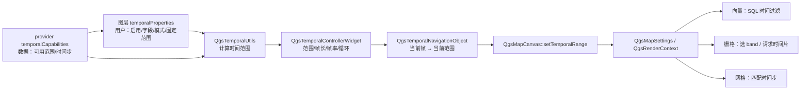

# QGIS 3.44 时间维度机制研究

> 只读研究：QGIS 源包 `QGIS-final-3_44_15.tar.gz` 解包到仓库外临时目录
> `D:\qgis-src-34415\QGIS-final-3_44_15`（只提取 `src/`、`python/`、`resources/`）。
> 未改动本仓任何代码。
>
> 对照基线：`d:\mbdsdr\MBDSDR` 当前工作区；行号以 3.44.15 源包为准。
> QGIS 侧为源码相对路径（文内 `file:///` 指向临时解包目录），本仓侧用 `file:///` 指向工作区文件。

## 0. 一页结论

| 维度 | QGIS 的核心答案 | 我们的现状 | 结论 |
|---|---|---|---|
| 时间范围表示 | 一个 `QgsDateTimeRange`，时刻就是 `[t,t]`，无效端点表示无限 | 只有"当前时刻"+ 各面板各自的窗口参数，无共享区间类型 | 可加，建议先加 |
| 控制器 | 只对外发"当前范围"一个信号，四种导航模式 | `TimeEngine` 只维护一个 JD + 倍率，无范围 | 部分可加，保留现有时刻源 |
| 时间依赖声明 | 图层 `temporalProperties`（用户意图）与 provider `temporalCapabilities`（数据事实）分离，随图层 XML 持久化 | 地图图层是 `(name, painter_callback)`，无任何时间元数据 | 可加轻量版，不照搬类体系 |
| 动画/步进 | 范围 + 帧长 + 帧率 + 帧号，QTimer 推进，可循环、可累积、可不规则步长 | 30 fps 重绘 + 时间倍率连续推进，无帧、无循环、无导出 | 大多数不加，理由见 §4 |
| 时刻与区间并存 | 同一类型 + 多种图层模式换算，栅格另有双时间与相对时间 | 只有瞬时；过境是 `rise/culm/set` 三元组 | 区间类型可加；双时间/相对时间只借概念 |
| 无时间信息 | 没有文案标记，靠"对象为空/未激活/无能力/无指示器"表达；缺省时给任意 24h | 无统一标记；仅"无 TLE"这类数据缺失提示 | 应加显式标记，且不要学 24h 兜底 |

## 1. QGIS 的时间数据流

关键点：控制器不直接命令图层"跳到某时刻"，而是广播一个**当前范围**；每个图层按自己的声明方式决定在这个范围里显示什么。

---

## 2. 时间控制器怎么表达时间范围

### 2.1 一种区间类型，时刻是零长度的区间

**QGIS 的做法**

- 时间范围只有一种值类型：`QgsDateTimeRange` 是模板 `QgsTemporalRange<QDateTime>` 的具体化，定义在 `src/core/qgsrange.h:761`。
- 时刻与区间不分成两个类型：`isInstant()` 直接判断 `begin == end` 且至少一端包含边界（`src/core/qgsrange.h:475`）。
- 两侧端点可以是"无效值"，表示该侧无限：`isInfinite()` 要求两端都无效（`qgsrange.h:482-485`），单端无效在区间运算里按半无限处理（`qgsrange.h:598-608`）。
- 同一类型上提供 `contains()`（`qgsrange.h:544-566`）、`overlaps()`（`qgsrange.h:572-610`）、`mergeRanges()`（`qgsrange.h:685-713`），后者把重叠/相邻区间合并，专门服务"非连续可用时间"。

**我们现在的对应实现与差距**

- 没有共享区间类型。`TimeEngine` 只保存一个儒略日 `_jd` 与倍率 `_rate`（[new_spacetime.py:121-199](file:///D:/mbdsdr/MBDSDR/mbdsdr_ai/new_spacetime.py#L121-L199)）。
- 跨模块约定的"时间"是 UTC 秒（[time-source.md:80-88](file:///D:/mbdsdr/MBDSDR/docs/time-source.md#L80-L88)），只有点没有段。
- 唯一的区间形状是卫星过境的三元组 `rise/culm/set`（[sat_passes.py:319-342](file:///D:/mbdsdr/MBDSDR/mbdsdr_ai/sat_passes.py#L319-L342)），且没有 `contains/overlaps/merge` 语义。

**能不能加**

能，且是本轮最值得先加的一块：在 `mbdsdr_ai` 放一个纯 Python 的 `TimeRange`（UTC 秒对 + 开闭端点 + `is_instant/is_empty/overlaps/contains/merge`），不改任何现有调用点，先让新代码用。

**不加的理由**

没有不做的理由。唯一约束是：不要做成 `datetime` 与 unix 秒两套内部表示，内部统一 UTC 秒，展示层再格式化，避免出现第五套时间源（现有四套见 [time-source.md:6-17](file:///D:/mbdsdr/MBDSDR/docs/time-source.md#L6-L17)）。

### 2.2 控制器只广播"当前范围"一个信号

**QGIS 的做法**

- 抽象基类 `QgsTemporalController` 只有一个信号 `updateTemporalRange(QgsDateTimeRange)`（`src/core/qgstemporalcontroller.h:72`），所有时间消费者都只是它的接收方。
- `QgsTemporalNavigationObject` 在范围、帧长、帧率、帧号、循环任一变化时重新计算并广播；播放状态另有 `stateChanged`（`src/core/qgstemporalnavigationobject.h:243-275`）。
- 导航模式是封闭枚举：`Disabled / Animated / FixedRange / Movie`（`src/core/qgis.h` 中 `TemporalNavigationMode`）。模式分发在 `setNavigationMode()`（`src/core/qgstemporalnavigationobject.cpp:142-166`），帧到范围的换算在 `dateTimeRangeForFrameNumber()`（`qgstemporalnavigationobject.cpp:110-140`）：
  - `Animated`：每帧一个 `[frameStart, frameStart+frameDuration)`；
  - `FixedRange`：整个范围永远作为一个区间发出；
  - `Movie`：没有范围，只有帧号（用于纯动画素材）；
  - `Disabled`：不广播时间。

**我们现在的对应实现与差距**

- `TimeEngine` 是全局单例式时刻源，UI 通过 `set_rate/resume/pause/tick` 改它（[new_spacetime.py:121-262](file:///D:/mbdsdr/MBDSDR/mbdsdr_ai/new_spacetime.py#L121-L262)）。
- 状态栏的倍率组合是"停 / 1× / 60× / 600×"，回到 1× 时直接重置为当前真实时间（[main_window.py:3248-3275](file:///D:/mbdsdr/MBDSDR/desktop/main_window.py#L3248-L3275)、[main_window.py:3300-3364](file:///D:/mbdsdr/MBDSDR/desktop/main_window.py#L3300-L3364)）。
- 天空视图另有一套倍率按钮与 ±10 分钟调整（[rf_sky_view.py:8424-8458](file:///D:/mbdsdr/MBDSDR/desktop/rf_sky_view.py#L8424-L8458)、[rf_sky_view.py:8516-8575](file:///D:/mbdsdr/MBDSDR/desktop/rf_sky_view.py#L8516-L8575)）。
- 差距：没有"范围"这个概念，也没有统一的接收方；各面板自己取 `now_unix()` 再自行加窗口参数。

**能不能加**

部分能加：保留 `TimeEngine` 作为唯一"当前时刻"真值源，另加一个可选的"导航窗口"（begin/end）状态，由 `TimeEngine` 对外发一个 `range_changed` 信号。不要把 `TimeEngine` 改成帧控制器。

**不加完整控制器的理由**

我们的核心交互是"跟随墙钟、可快进/倒带看天象"，连续 rate 模型比有界帧模型更贴合；引入 `Animated/FixedRange/Movie` 四模式会与现有"回 1× 即回现在"的语义冲突，并把简单问题复杂化。

### 2.3 项目级默认范围与持久化

**QGIS 的做法**

- 项目级时间设置独立存在：`QgsProjectTimeSettings` 保存 `temporalRange()`、`timeStep()`、`framesPerSecond()`、`cumulativeTemporalRange()`（`src/core/project/qgsprojecttimesettings.h:63-155`）。
- 控件在修改时写进项目（帧长/单位：`src/gui/qgstemporalcontrollerwidget.cpp:271-274`；起止时刻：`saveRangeToProject()`，`qgstemporalcontrollerwidget.cpp:716-720`），项目重新打开时由 `setWidgetStateFromProject()` 读回（`qgstemporalcontrollerwidget.cpp:303-344`）。
- 图层添加/移除时控制器会自动重算范围；用户也可显式"从图层/从项目取范围"（`qgstemporalcontrollerwidget.cpp:220-249`、`404-430`）。

**我们现在的对应实现与差距**

- 没有"项目文档"概念，窗口参数（如过境预测小时数）来自设置项而不是文档状态；重建会话不会恢复"上次看的时间窗"。
- 差距不在持久化能力（QSettings 已有），而在于没有一个"时间窗"对象可存。

**能不能加**

等 §2.1 的 `TimeRange` 落地后，可以顺带把"上次使用的窗口 + 倍率"存进现有 settings，成本很小。

**不加项目级机制的理由**

我们没有多文档、多工程并存的场景；为单个会话做一套 `QgsProjectTimeSettings` 等价的工程文件结构属于过度设计。

### 2.4 画布只认一个范围，渲染器各自解释

**QGIS 的做法**

- `QgsMapCanvas::setTemporalController()` 把控制器接到画布（`src/gui/qgsmapcanvas.cpp:566-584`），模式变化时由导航对象决定是"每帧一刷"还是"只刷一次"（`qgsmapcanvas.cpp:586-607`）。
- `setTemporalRange()` 把范围写进 `QgsMapSettings` 并让缓存失效；只有 begin/end 都有效时才标记为 temporal，否则关闭时间过滤（`qgsmapcanvas.cpp:1352-1372`）。
- 渲染器从 `QgsRenderContext` 取范围，自行决定行为：向量拼 SQL（见 §3.4），栅格选 band，网格匹配时间步。

**我们现在的对应实现与差距**

- 我们有多个独立地图控件：`OsmMapView`（[osm_map.py:933-1036](file:///D:/mbdsdr/MBDSDR/desktop/osm_map.py#L933-L1036)）、地面站地图、ADS-B 地图、卫星影像面板等，彼此不共享"当前范围"。
- 天空视图在 33 ms 定时器里 `tick()` 后重绘（[rf_sky_view.py:2188-2207](file:///D:/mbdsdr/MBDSDR/desktop/rf_sky_view.py#L2188-L2207)、[rf_sky_view.py:3292-3306](file:///D:/mbdsdr/MBDSDR/desktop/rf_sky_view.py#L3292-L3306)），是"拉模型"；QGIS 是"推模型"。

**能不能加**

能加，但前提是先有统一的地图/图层抽象；否则只是把同样的广播逻辑在五个控件里各写一遍，违反"同一语义收敛到唯一入口"。

**不加（暂不加）的理由**

当前各面板的时间语义并不同（ADS-B 只有实时，天空是连续仿真，影像是离线历史），强行共用一个范围会产生"看起来联动、实际口径不同"的假一致性。先把区间类型和"无时间标记"做对，再谈统一范围。

---

## 3. 时间依赖图层怎么声明

### 3.1 图层对象挂一个"时间属性"，默认不激活

**QGIS 的做法**

- 基类 `QgsMapLayerTemporalProperties` 定义 `isActive()/setIsActive()`、`calculateTemporalExtent()`、`writeXml()/readXml()`（`src/core/qgsmaplayertemporalproperties.h:79-128`）。
- 开关状态在更底层的 `QgsTemporalProperty`：`isActive()` 只是返回 `mActive`（`src/core/qgstemporalproperty.h:55-69`）。
- 向量/栅格/网格图层在构造时就创建各自的 temporal properties 对象（`src/core/vector/qgsvectorlayer.cpp` 的 `new QgsVectorLayerTemporalProperties(...)`；栅格同理），**默认 `mActive=false`**；网格层构造参数默认 `enabled=true`（`src/core/mesh/qgsmeshlayertemporalproperties.h:63`）。
- `QgsMapLayer::temporalProperties()` 基类返回 `nullptr`（`src/core/qgsmaplayer.h`），所以"这个图层类型根本没有时间维度"是靠空指针表达的；点云层与注记层在 3.44 没有覆写该方法（全仓 grep 无 `TemporalProperties`）。

**我们现在的对应实现与差距**

- 我们的"图层"是绘制回调：`OsmMapView._layers` 存 `(name, paint_callable)`，`add_layer()` 只做注册与重绘（[osm_map.py:933-936](file:///D:/mbdsdr/MBDSDR/desktop/osm_map.py#L933-L936)、[osm_map.py:1021-1036](file:///D:/mbdsdr/MBDSDR/desktop/osm_map.py#L1021-L1036)）。没有元数据、没有持久化、没有时间声明。
- 天空视图的"图层"是布尔开关（卫星/太阳/月亮/网格等），只影响画不画，不影响"某时刻有没有数据"。

**能不能加**

能加轻量版：给图层注册增加一个可选 `TemporalMeta`（`enabled: bool`、`source: live|replay|static`、`time_field` 或 `frame_time`、`fixed_range`）。不引入多态类体系，用一个 dataclass 即可。

**不加完整框架的理由**

QGIS 的多态体系服务于"任意 provider + 任意时间模式"的通用性；我们只有三类数据（实时流、离线帧、轨道计算），用三个枚举值即可表达，做类层次只会增加维护面。

### 3.2 "用户声明"与"数据能力"分离

**QGIS 的做法**

- 数据侧：`QgsDataProvider::temporalCapabilities()` 默认返回 `nullptr`（`src/core/providers/qgsdataprovider.h:208`）；有能力的 provider 返回具体对象。
- 用户侧：图层的 `QgsVectorLayerTemporalProperties` 决定"是否启用、用哪两个字段、时刻还是区间"；它还会从 provider 能力里猜默认值（`src/core/vector/qgsvectorlayertemporalproperties.cpp:334-352` 的 `setDefaultsFromDataProviderTemporalCapabilities`）。
- 栅格侧：`QgsRasterDataProviderTemporalCapabilities` 给出可用时间范围、默认步长、以及能力标志（时间在文件名里/在 band 描述里等，`src/core/qgis.h` 的 `RasterTemporalCapabilityFlags`）；界面上的 `Automatic` 模式只有在 provider 有能力时才出现（`src/gui/raster/qgsrasterlayertemporalpropertieswidget.cpp:51-54`）。

**我们现在的对应实现与差距**

- 我们没有"数据能力"这一层：能不能按时间筛选，完全由各面板代码隐式决定。
- 典型例子：卫星影像文件名里带 `int(time.time())`（LRPT：[satellite_image_panel.py:289](file:///D:/mbdsdr/MBDSDR/desktop/satellite_image_panel.py#L289)；APT：[satellite_image_panel.py:405-408](file:///D:/mbdsdr/MBDSDR/desktop/satellite_image_panel.py#L405-L408)），但历史列表只显示原始文件名（[satellite_image_panel.py:433-441](file:///D:/mbdsdr/MBDSDR/desktop/satellite_image_panel.py#L433-L441)），不解析成时刻，更不参与时间轴。
- ADS-B 只有实时快照（`AircraftTracker`），没有历史，因此"无时间能力"这件事也没有被声明。

**能不能加**

能，且建议加：给每个数据面板/数据源一个显式的 `TemporalCapability`（`none / live_only / timestamped_frames`），UI 据此显示"仅实时/可按时间回看/无时间维度"。这一步不改数据管线，只加声明与展示。

**不加完整分离的理由**

QGIS 的分离是为了插件生态：provider 与图层属性由不同团队实现。我们是单体应用，声明放在数据源旁边即可，不需要两套可扩展接口。

### 3.3 时间属性随图层持久化

**QGIS 的做法**

- 图层 XML 里写 `<temporal enabled="1" mode="...">`（向量：`src/core/vector/qgsvectorlayertemporalproperties.cpp:301-313`；栅格：`src/core/raster/qgsrasterlayertemporalproperties.cpp` 的 `writeXml()`），并由 `QgsMapLayer` 统一调度（`src/core/qgsmaplayer.cpp:886-890`、`2541-2547`）。
- 瞬时栅格单独持久化为 `fixedInstant`，读回时再折算成 `[t,t]`（`src/core/raster/qgsrasterlayertemporalproperties.cpp:417-425`）。

**我们现在的对应实现与差距**

- 图层不可持久化（回调无法序列化），面板状态靠 settings 里的少量键。没有"这个数据集的时间口径"记录。
- 差距：同一份历史影像重新打开后，无法知道"它是按接收时刻命名的、应落在哪个时间轴"。

**能不能加**

部分能加：为离线数据（影像/云图/记录文件）在 sidecar 元数据里记录 `time_basis` 与 `time_range`，随文件走；不需要图层 XML。

**不加图层 XML 的理由**

我们没有图层文档格式；为持久化而发明一种工程文件格式，收益低于成本。sidecar 是更小、更可移植的落点。

### 3.4 渲染期才执行时间过滤

**QGIS 的做法**

- 向量：`QgsVectorLayerRenderer` 在绘制前把时间范围翻译成 SQL 过滤串（`src/core/vector/qgsvectorlayerrenderer.cpp:126-131`），再把它并入要素请求（`qgsvectorlayerrenderer.cpp:378-381`）。
- `createFilterString()` 按模式生成表达式（`src/core/vector/qgsvectorlayertemporalproperties.cpp:447-620`）：
  - 单字段区间：`field >= begin AND field <= end`；
  - 双字段：`start <= end AND (start <= endRange AND end >= startRange)`；
  - 瞬时字段 + 固定时长：先把 `[begin,end]` 各减去/加上 duration，再比较；
  - 固定范围模式：返回空过滤（不按要素过滤），是否显示由 `isVisibleInTemporalRange()` 决定（`qgsvectorlayertemporalproperties.cpp:32-46`）。
- 栅格：整层是否参与时间过滤由通用渲染器裁定——`isVisibleInTemporalRange()` 返回假时该层直接不画（`src/core/maprenderer/qgsmaprendererjob.cpp:580`；栅格判定见 `src/core/raster/qgsrasterlayertemporalproperties.cpp:29-56`），参与时才按 `FixedRangePerBand` 等模式选 band（`qgsrasterlayerrenderer.cpp:345-360`）。

**我们现在的对应实现与差距**

- 我们的"过滤"发生在取数阶段而不是渲染阶段：过境窗口 `[now, now+hours]` 直接传给预测器（[new_spacetime_timeline.py:284-330](file:///D:/mbdsdr/MBDSDR/mbdsdr_ai/new_spacetime_timeline.py#L284-L330)、[sat_passes.py:93-109](file:///D:/mbdsdr/MBDSDR/mbdsdr_ai/sat_passes.py#L93-L109)）。
- 差距：过滤口径散落在调用方，没有一个"给定范围，返回该范围内的数据"的统一入口。

**能不能加**

能加，但只对真有帧序列的数据做（例如影像历史、将来的记录回放）；对实时流没有意义。

**不加到所有面板的理由**

实时数据按定义只有"现在"，给它加范围过滤只会制造空结果；这属于"不该做的抽象"。

### 3.5 支持边界本身就是一种声明

**QGIS 的做法**

- 图层树时间指示器只处理 `Vector / Raster / Mesh` 三种图层，其余类型不显示指示器（`src/app/qgslayertreeviewtemporalindicator.cpp:48-66`）。
- 指示器只在 `temporalProperties()->isActive()` 为真时出现，tooltip 为 "Temporal layer"（`qgslayertreeviewtemporalindicator.cpp:69-86`）。
- 点云、注记图层没有 temporal properties，因此在时间维度上"不存在"，而不是"存在但为空"。

**我们现在的对应实现与差距**

- 我们没有图层树，也没有等价的"时间指示器"；用户无法从界面看出某个面板是否支持时间。
- 差距是可见性，不是能力：有些面板其实有时间信息（影像文件名的 unix 秒），只是没被承认。

**能不能加**

能，且成本最低：在面板标题/状态栏加一个时间口径标签（`实时 / 可按时间查看 / 无时间`），并在"无时间"时说明原因。

**不加图层树指示器的理由**

我们没有图层树；复制一个图标机制会引入一套无处安放的 UI 位置。用现有的面板标题与状态栏承载即可。

---

## 4. 动画与时间步进怎么实现

### 4.1 帧模型：范围 + 帧长 + 帧率 + 帧号

**QGIS 的做法**

- `QgsTemporalNavigationObject` 的核心状态是：时间范围、帧长 `QgsInterval`、帧率、当前帧号、总帧数（`src/core/qgstemporalnavigationobject.h:340-369`）。
- 默认值很保守：帧长 1 小时、帧率 1 fps、Movie 模式 100 帧、模式 `Disabled`（同上）。
- 当前帧被强制夹在 `[0, totalFrameCount()-1]`（`src/core/qgstemporalnavigationobject.cpp:216-226`，夹紧在 220 行），所以不能把动画设到范围外。
- 帧号到时间范围是纯函数：`frameStart = extents.begin() + frameNumber * frameDuration`，结束端要么加帧长，要么等于范围结束（`qgstemporalnavigationobject.cpp:110-140`）。
- 播放由 `QTimer` 驱动，间隔由帧率换算（`qgstemporalnavigationobject.cpp:258-265`）；每次超时推进一步，到达边界时按方向自动回卷或停止（`qgstemporalnavigationobject.cpp:33-63`）。

**我们现在的对应实现与差距**

- 我们只有连续时间：`TimeEngine.tick()` 用单调钟算真实经过时间，再乘倍率累加到模拟 JD（[new_spacetime.py:218-261](file:///D:/mbdsdr/MBDSDR/mbdsdr_ai/new_spacetime.py#L218-L261)）。
- 重绘由 30 fps 定时器驱动（[rf_sky_view.py:2188-2207](file:///D:/mbdsdr/MBDSDR/desktop/rf_sky_view.py#L2188-L2207)）。
- 没有帧号、没有总帧数、没有"到边界回卷"，也没有动画状态枚举。

**能不能加**

可以加一个"有界回放"子模式（给定 `TimeRange` + 固定步长，按步推进并在末端停止），但应作为独立对象，不改造 `TimeEngine`。

**不加帧模型的理由**

我们的时间推进是"实时时钟 × 倍率"，帧号是人为量化；一旦引入帧号，`now` 与当前帧就会有两个真值源。除非有明确的"逐帧回放数据集"需求，否则不引入。

### 4.2 循环与边界行为

**QGIS 的做法**

- `setLooping()` 控制边界行为（`src/core/qgstemporalnavigationobject.cpp:86-89`）：到末端后回到起点继续播；不循环则停在边界并转 idle（`qgstemporalnavigationobject.cpp:33-63`）。
- 还有"跳到开头/结尾"的显式槽 `rewindToStart()/skipToEnd()`（`qgstemporalnavigationobject.h:322-330`，实现见 `qgstemporalnavigationobject.cpp:335-344`）。

**我们现在的对应实现与差距**

- 没有循环。倍率回到 1× 时直接 `set_time_now()`（[main_window.py:3343-3357](file:///D:/mbdsdr/MBDSDR/desktop/main_window.py#L3343-L3357)），这是一种"回到现在"的隐式边界行为。
- 天空视图的 ±10 分钟是一次性偏移，没有边界概念（[rf_sky_view.py:8532-8575](file:///D:/mbdsdr/MBDSDR/desktop/rf_sky_view.py#L8532-L8575)）。

**能不能加**

能加，但优先级低：只有当"回放一段固定历史"成为真实需求时才需要。

**不加的理由**

当前所有快进都是无限向前的天象浏览，"循环"没有明确的产品语义（循环一昼夜？循环一次过境？），先不做。

### 4.3 不规则步长（由数据决定时间轴）

**QGIS 的做法**

- 时间步长单位支持 `IrregularStep`（`src/core/qgis.h` 的 `TemporalUnit` 枚举），此时帧不对应固定时长。
- 控制器在单位切到 `IrregularStep` 时禁用步长输入框并把滑杆改为逐帧刻度（`src/gui/qgstemporalcontrollerwidget.cpp:288-294`）。
- 总帧数与帧到范围的换算改为遍历 provider 给出的所有时间范围（`src/core/qgstemporalnavigationobject.cpp:346-360`、`121-127`）；
- 帧号定位是"先按帧长估一个起点、再线性扫描到命中"（源码注释解释：不能从 0 遍历，否则毫秒级帧长会冻结界面），`qgstemporalnavigationobject.cpp:376-420`；不规则步长时退化为遍历时间范围列表。

**我们现在的对应实现与差距**

- 没有多帧数据的时间轴；过境预测用固定步长（粗 60 s / 细 2 s，[sat_passes.py:93-109](file:///D:/mbdsdr/MBDSDR/mbdsdr_ai/sat_passes.py#L93-L109)）。
- 差距：网格化的时间轴是"计算参数"，不是"数据自带的时间戳集合"。

**能不能加**

将来有"按帧记录"的数据（例如 IQ 分段、逐帧解码图像）时可以加。

**不加的理由**

当前没有不规则时间步的数据源；为一个不存在的场景实现二分定位属于空转。

### 4.4 累积区间

**QGIS 的做法**

- `setTemporalRangeCumulative(true)` 后，发出的范围从 `extents.begin()` 一直延伸到当前帧结束，而不是单帧窗口（`src/core/qgstemporalnavigationobject.cpp:136-139`；状态变更在 `272-283`）。
- 控制器 UI 用复选框暴露该选项，并随项目级设置读写（`src/gui/qgstemporalcontrollerwidget.cpp:303-344`；导出对话框初始化见 `src/app/qgsanimationexportdialog.cpp:116`）。

**我们现在的对应实现与差距**

- 天空视图的卫星轨迹本身就是"从过去某点到当前"的累积绘制，但没有把它表达为一个时间区间，也没有开关。
- 差距：累积是绘制实现细节，不是可查询的状态。

**能不能加**

概念可借，机制不必加：如果将来要"显示截至当前时刻的全部历史"，用 `TimeRange(begin, now)` 表达即可。

**不加累积模式的理由**

我们的累积需求已经由绘制层满足；再加一个导航模式会造成两处控制同一件事。

### 4.5 时间上下文变量（表达式）

**QGIS 的做法**

- 导航对象提供一个表达式上下文作用域，暴露 `animation_start_time`、`animation_end_time`、`animation_interval`、`frame_number`、`frame_rate` 等变量（`src/core/qgstemporalnavigationobject.cpp:91-108`）。
- 图层样式/标注可以引用这些变量，实现"按帧变化"的符号。

**我们现在的对应实现与差距**

- 没有表达式引擎，也没有按帧变化的样式需求。差距不构成问题。

**能不能加**

不建议加。

**不加的理由**

引入表达式系统会带来解析、求值、错误处理的完整负担；我们的视觉随时间变化由代码直接计算，不需要再抽象一层。

### 4.6 离屏动画导出

**QGIS 的做法**

- `QgsTemporalUtils::exportAnimation()` 逐帧渲染：每帧设置当前帧号与范围、追加表达式上下文、用 `QgsMapRendererCustomPainterJob` 画到 `QImage` 并保存（`src/core/qgstemporalutils.cpp:68-165`，渲染在 `143-159`）。
- 导出设置 `AnimationExportSettings` 含 `animationRange`、`frameDuration`、`frameRate`（默认 30）、`fileNameTemplate`、`availableTemporalRanges`、`temporalRangeCumulative`（`src/core/qgstemporalutils.h:147-195`）；文件名模板支持 `####` 之类的占位（`src/app/qgsanimationexportdialog.cpp:68-72`），导出的是**帧序列**（PNG 等），不是视频，帧率只写进 `QgsMapSettings` 由渲染器使用。
- 开始/结束时间取自控制器当前范围，界面只允许微调（`qgsanimationexportdialog.cpp:108-132`）。

**我们现在的对应实现与差距**

- 没有任何动画导出；`grep` 全仓无"导出帧序列/编码视频"的实现。
- 差距是功能缺口，不是架构缺陷。

**能不能加**

能加：把天空视图的绘制函数抽成"给定时刻渲染到 QImage"，再循环导出即可。

**不加的理由**

这是新功能而非时间维度的修正；当前没有导出视频/帧序列的需求，且它会把 30 fps 的实时路径与离线渲染路径分开维护，成本高于收益。等有人真的需要"把一次过境导出成视频"时再立项。

---

## 5. 时刻与区间怎么并存

### 5.1 同一类型 + 端点语义

**QGIS 的做法**

- 时刻不是独立类型，而是 `[t,t]`（`qgsrange.h:475`）。
- 端点的开闭是类型的一部分（`includeLower/includeUpper`），`contains()`/`overlaps()` 都按开闭判断（`qgsrange.h:544-610`）。
- "无限"与"空"是两种不同状态：两端无效是无限（`qgsrange.h:482-485`），起止颠倒（或相等且都不含边界）是空（`qgsrange.h:492-507`）。

**我们现在的对应实现与差距**

- 只有瞬时（`now_unix()`），没有端点开闭概念。
- 过境的上升/落下时刻在比较时按浮点秒处理，端点是否包含没有统一约定。

**能不能加**

能，作为 §2.1 的 `TimeRange` 的一部分。

**不加的理由**

无；但不要为端点开闭发明两套比较函数，统一走 `contains/overlaps`。

### 5.2 向量：时刻通过"固定时长"折算成区间

**QGIS 的做法**

- 向量时间模式包含：单字段（起止同一字段 + 固定时长）、双字段、瞬时字段、固定范围（`src/core/qgis.h` 的 `VectorTemporalMode`）。
- 瞬时字段 + 时长时，先把查询范围两端各扩/缩 duration，再用同一个字段比较（`src/core/vector/qgsvectorlayertemporalproperties.cpp:469-493`）：
  - 查询 `[begin,end]`、事件时长 `d`，等价于找 `t` 使 `[t, t+d]` 与 `[begin,end]` 相交，即 `t <= end` 且 `t >= begin-d`。
- 没有时长时，瞬时事件按"点"处理（`t` 落在范围内）。
- 提供"限界模式" `IncludeBegins/IncludeEnds/Exclude...`（`qgis.h` 的 `VectorTemporalLimitMode`），控制是否把与范围端点相接的事件算进来。

**我们现在的对应实现与差距**

- 卫星过境天然是区间（`rise/max/set`），但只作为 Python 对象字段存在，没有"事件时长"与"与查询区间相交"的统一语义。
- 差距：同一个问题（"这次过境是否落在用户关心的时段里"）由调用方各自比较。

**能不能加**

能，且值得：`SatellitePass` 可以暴露 `as_range()`，查询统一用 `TimeRange.overlaps()`。

**不加向量模式体系的理由**

我们没有"要素表 + 时间字段"的通用数据模型，五种模式无处落地；只借"瞬时 + 时长 → 区间"这一条数学换算。

### 5.3 栅格：瞬时、时间段、按 band、代表值、双时间

**QGIS 的做法**

- 栅格时间模式包含 `FixedTemporalRange`、`FixedRangePerBand`、`RepresentsTemporalValues`、`FixedDateTime`（`src/core/qgis.h` 的 `RasterTemporalMode`）。
- `FixedDateTime` 是真正的"单时刻"模式，内部仍存成 `[t,t]`（`src/gui/raster/qgsrasterlayertemporalpropertieswidget.cpp:126-131`），持久化为 `fixedInstant`（`src/core/raster/qgsrasterlayertemporalproperties.cpp:417-425`）。
- `FixedRangePerBand` 为每个 band 存起止时间，渲染时按范围匹配 band（`src/core/raster/qgsrasterlayertemporalproperties.h:111-129`、`src/core/raster/qgsrasterlayerrenderer.cpp:344-360`）。
- 双时间：provider 能力区分**名义时间**（数据描述的时间）与**参考时间**（数据产生/参考的时间），各自有可用范围（`src/core/raster/qgsrasterdataprovidertemporalcapabilities.h:117-131`）。
- 还有"时间表示偏移"，用于"文件名时间 = 时段开始 + 偏移"这类约定（`qgsrasterlayertemporalproperties.h:166-174`）。

**我们现在的对应实现与差距**

- 影像/云图只有**接收时刻**（文件名 unix 秒），没有拍摄时刻，也没有"这段时间代表哪段观测"。
- 差距：正是 QGIS 用"双时间 + 表示偏移"解决的那类问题，我们目前用"文件名里的一个数"隐式表达。

**能不能加**

部分能加：在影像 sidecar 里记录 `capture_time`（若可用）与 `received_time`，缺失时明确标"拍摄时刻未知"。

**不加双时间机制的理由**

数据源本身不提供拍摄时刻，建立两条时间轴只会产生大量空值；正确的做法是"能填则填、不能填就标未知"，而不是引入一套双时间模型来承载未知。

### 5.4 网格：参考时刻 + 相对时间

**QGIS 的做法**

- 网格图层的头文件直接画出三种时间：绝对时间、相对时间、参考时刻（`src/core/mesh/qgsmeshlayertemporalproperties.h:36-46`）。
- provider 可以给全局参考时刻，也可以给每个数据集组单独的参考时刻（`src/core/mesh/qgsmeshdataprovidertemporalcapabilities.h:76-151`）。
- 时间设置里还区分"绝对时间 / 从参考时刻起的相对时间"等展示格式（`src/core/mesh/qgsmeshtimesettings.h:43-75`）。

**我们现在的对应实现与差距**

- 这正是卫星域的模型：TLE 历元就是参考时刻，传播时间是相对量；`tle_integrity` 已经在用"历元 + 年龄"判断新鲜度（[tle_integrity.py](file:///D:/mbdsdr/MBDSDR/mbdsdr_ai/tle_integrity.py)）。
- 差距：界面上没有把"绝对时刻"与"相对历元的时间"并置显示；用户只看到 UTC 时刻。

**能不能加**

能，且建议：在卫星相关面板同时显示 `UTC 时刻` 与 `相对 TLE 历元 +xx.x h`，并标注历元本身。这不需要新机制，只是展示层。

**不加网格时间设置体系的理由**

我们不需要"每个数据集组一个参考时刻"的通用性；一条卫星一个历元，字段足够。

### 5.5 边界开闭与"没有时间戳的要素"

**QGIS 的做法**

- 向量过滤串对端点使用 `>=`/`>`、`<=`/`<`，由限界模式决定（`qgsvectorlayertemporalproperties.cpp:469-620`）。
- 特别注意：所有**基于字段**的模式生成的过滤条件都带 `OR <field> IS NULL`（单瞬时：`qgsvectorlayertemporalproperties.cpp:479-483`；瞬时+固定时长：`488-492`；起+时长：`545-551`；起止双字段：`558-563`）。也就是说，**时间字段为空的要素在时间过滤下永远显示**，而不是被隐藏。例外是基于表达式的模式（`581-605`），它不带 IS NULL 兜底。
- 栅格如果与范围完全不相交则整层不画（`src/core/maprenderer/qgsmaprendererjob.cpp:580` 调 `isVisibleInTemporalRange()`，栅格判定见 `src/core/raster/qgsrasterlayertemporalproperties.cpp:29-56`），语义比向量更"硬"。

**我们现在的对应实现与差距**

- 我们没有"NULL 时间"的处理约定：数据缺失时通常是整块不显示或显示错误，而不是"保留显示并标注未知"。
- 差距是语义级的：时间过滤遇到缺失值时该显示还是隐藏，没有统一答案。

**能不能加**

能，且应作为 `TimeRange` 使用规范的一部分明确写死：**时间未知的数据默认显示，并带"时间未知"标记，不因过滤而被静默隐藏**。这与我们"不静默降级、错误要可见"的既有约定一致。

**不加（照搬）的理由**

QGIS 的 NULL 恒显示是合理默认，但它是隐式的（藏在 SQL 串里），我们不照搬其隐式性，而是把它变成显式约定与可见标记。

### 5.6 对象级时间范围

**QGIS 的做法**

- `QgsTemporalRangeObject` 让非图层对象（装饰、布局项等）也能声明自己的时间范围（`src/core/qgstemporalrangeobject.h:33-82`），并挂在 `QgsTemporalController` 体系下参与过滤。

**我们现在的对应实现与差距**

- 天空视图里的卫星、太阳、月亮、地面站都是绘制对象，没有"有效时间"概念；TLE 过期后对象仍会按旧轨道画出来（新鲜度只在数据层判断，见 `tle_integrity`）。
- 差距：对象级"此刻是否可信"没有表达。

**能不能加**

能，价值中高：给每个天体对象带上"数据有效窗口"，过期时在对象上标注"轨道数据过期，位置不可信"。

**不加完整对象体系的理由**

不需要通用容器；把 `valid_range` 作为对象字段即可，不要复制 `QgsTemporalRangeObject` 的类层次。

---

## 6. 没有时间信息的数据怎么标

### 6.1 QGIS 的标记方式是"结构性缺省"，不是文案

**QGIS 的做法**

- 图层类型不支持时间：`temporalProperties()` 返回 `nullptr`（点云、注记；见 §3.1）。
- 支持但未启用：对象存在、`isActive()==false`（`qgstemporalproperty.h:55-69`）。
- 数据源没有时间能力：`temporalCapabilities()` 返回 `nullptr`（`src/core/providers/qgsdataprovider.h:208`）。
- 图层树不显示时间指示器（`qgslayertreeviewtemporalindicator.cpp:69-86`）。
- 全仓 grep 未找到面向用户的 "No temporal information" 类文案；唯一相近的是 `Temporal navigation disabled`（控制器模式为 Disabled 时的占位文本，`src/gui/qgstemporalcontrollerwidget.cpp:507`）。

**我们现在的对应实现与差距**

- 没有统一标记。仅有的"缺数据"提示是局部文案，例如天空视图在无 TLE 时显示"无 TLE 数据"（[rf_sky_view.py:8071](file:///D:/mbdsdr/MBDSDR/desktop/rf_sky_view.py#L8071)、[rf_sky_view.py:8136](file:///D:/mbdsdr/MBDSDR/desktop/rf_sky_view.py#L8136)）。
- 差距：用户无法区分"这个面板没有时间维度"与"有时间维度但当前没数据"。

**能不能加**

能，且建议：每个数据面板声明一个三态 `time_capability = none | live_only | time_axis`，并在标题栏显示；`none` 时说明原因（如"ADS-B 仅提供实时快照"）。

**不加 QGIS 式结构缺省的理由**

结构缺省对开发者清晰，对用户不可见；我们的用户界面需要直接给出"为什么不能按时间看"，否则会被误解为功能损坏。

### 6.2 UI 只展示数据支持的模式

**QGIS 的做法**

- 栅格属性页的 `Automatic` 模式只在 provider 有 temporal capabilities 时加入下拉框（`src/gui/raster/qgsrasterlayertemporalpropertieswidget.cpp:51-54`）。
- 时间属性页的开关叫 "Dynamic Temporal Control"（`src/ui/raster/qgsrasterlayertemporalpropertieswidgetbase.ui`、`src/ui/qgsvectorlayertemporalpropertieswidgetbase.ui`），勾选才启用。

**我们现在的对应实现与差距**

- 没有"按数据能力裁剪 UI"的机制：倍率按钮、时间跳转对所有面板一视同仁，即使该面板的数据不受时间影响。

**能不能加**

能：把倍率控件与"时间跳转"入口在 `time_capability==none` 的面板里置灰，并给出原因。

**不加的理由**

无；这是低成本、高收益的防误解改动。

### 6.3 缺省兜底：QGIS 给的是任意 24 小时

**QGIS 的做法**

- 项目清空或首次打开时，控制器把范围设为"最后 24 小时"（`src/gui/qgstemporalcontrollerwidget.cpp:455-476`），源码注释明确写着这是 "COMPLETELY arbitrary"。
- 添加第一个时间图层时，用该图层的时间范围初始化控制器（`qgstemporalcontrollerwidget.cpp:404-430`）。
- 项目范围优先于图层范围，避免被单个图层"拽走"（同上）。

**我们现在的对应实现与差距**

- 我们没有这种兜底：天空视图始终跟随当前时刻或用户设定的偏移，语义明确。
- 差距不是缺陷；QGIS 的兜底是"没有时间信息时也要让界面有东西可显示"的妥协。

**能不能加**

不建议。

**不加的理由**

任意窗口会把"我不知道"伪装成"我知道"，与"不得用典型值冒充当天值"的既有约定冲突。正确行为是明确显示"未设定时间范围"，而不是悄悄给一个 24 h。

### 6.4 元数据里的时间范围是另一条线

**QGIS 的做法**

- `QgsLayerMetadata` 有独立的 `temporalExtents()`，每个范围可以是瞬时或区间（`src/core/metadata/qgslayermetadata.h:106-119`）。
- 它与 `temporalProperties` 互不替代：前者是"数据集描述"，后者是"渲染时怎么筛"。

**我们现在的对应实现与差距**

- 没有数据集元数据；影像/云图的时间信息只活在文件名里。
- 差距：离线数据的"覆盖时段"无法被检索或展示。

**能不能加**

部分能加：给离线数据 sidecar 记录 `time_coverage`（起止 + 是否瞬时），并在列表里显示。

**不加 ISO 元数据体系的理由**

我们不需要导出/交换地理元数据；一个 sidecar JSON 足够。

### 6.5 "无时间"与"时间未知"必须区分

**QGIS 的做法**

- 二者的处理不同：图层不支持时间 → 整个时间维度不存在；要素时间字段为空 → 该要素在时间过滤下仍然显示（§5.5）。
- 但界面上并不显式区分这两者，用户只能从"有没有时间指示器"推断。

**我们现在的对应实现与差距**

- 我们既没有"无时间维度"标记，也没有"时间未知但保留显示"的约定。
- 差距：这两类情况都会被用户理解为"功能坏了"。

**能不能加**

能，且应作为规范：
1. `无时间维度`：面板级声明 + 文案（为什么没有）；
2. `时间未知`：数据级标记 + 保留显示，不参与时间过滤；
3. `时间已知但过期`：显示时刻 + 过期程度（TLE 年龄已有此能力）。

**不加的理由**

无；这是本轮第二优先的落地项。

---

## 7. 差距与取舍总表

| # | QGIS 能力 | 我们的现状 | 能不能加 | 结论与理由 |
|---|---|---|---|---|
| 1 | `QgsDateTimeRange` 统一区间 | 无区间类型 | 能 | 建议加：纯值类型，零侵入，先解决"窗口/过境/帧"各写各的 |
| 2 | `updateTemporalRange` 统一广播 | 各面板自取当前时刻 | 部分 | 暂不加：面板时间语义不同，强行联动会造成假一致 |
| 3 | 项目级时间设置持久化 | 无项目文档 | 能 | 不加：单会话应用，存 settings 即可 |
| 4 | 图层 temporalProperties | 图层=绘制回调 | 部分 | 加轻量 `TemporalMeta`，不做多态体系 |
| 5 | 用户声明 vs provider 能力 | 隐式在代码里 | 能 | 建议加：声明数据是否可按时间看 |
| 6 | 图层 XML 持久化 | 无图层格式 | 部分 | 用 sidecar，不发明工程文件 |
| 7 | 渲染期时间过滤 | 取数期各自过滤 | 部分 | 仅对帧序列数据统一入口 |
| 8 | 帧模型（范围/帧长/帧率/帧号） | 连续 rate | 部分 | 不加主模型；需要时做独立有界回放对象 |
| 9 | 循环与边界 | 回 1× 即回现在 | 部分 | 暂不加：无明确循环语义 |
| 10 | 不规则步长 | 固定步长 | 将来 | 暂不加：无多帧数据源 |
| 11 | 累积区间 | 绘制层已累积 | 概念 | 不加机制，用 `TimeRange(begin, now)` 表达 |
| 12 | 表达式时间变量 | 无表达式引擎 | 否 | 不加：引入完整解析求值不划算 |
| 13 | 离屏动画导出 | 无 | 能 | 不加：新功能，非时间维度缺陷 |
| 14 | 时刻=零长区间 | 仅瞬时 | 能 | 随 #1 一起加 |
| 15 | 瞬时+时长折算区间 | 过境三元组 | 能 | 建议加：`SatellitePass.as_range()` |
| 16 | 栅格多时间模式 | 单帧影像 | 部分 | 只借"瞬时/区间"概念，不做 band 时间轴 |
| 17 | 双时间（名义/参考） | 只有接收时刻 | 部分 | 不建双轴；缺失就标"拍摄时刻未知" |
| 18 | 网格参考时刻 | TLE 历元 | 展示 | 建议加：界面并置 UTC 与"相对历元 +x h" |
| 19 | NULL 时间恒显示 | 无约定 | 能 | 建议加：时间未知默认显示并标记 |
| 20 | 对象级时间范围 | 对象无有效窗 | 部分 | 加 `valid_range` 字段，不复制类层次 |
| 21 | 结构化的"无时间"标记 | 无 | 能 | 建议加：三态能力声明 + 文案 |
| 22 | 任意 24h 兜底 | 跟随当前时刻 | 否 | 不加：会把"不知道"伪装成"知道" |
| 23 | 元数据时间范围 | 文件名里的 unix 秒 | 部分 | 加 sidecar `time_coverage` |

## 8. QGIS 自身值得警惕的三处设计

这三条不是"我们做不到"，而是"我们不该照抄"：

1. **缺省任意 24 小时**：`qgstemporalcontrollerwidget.cpp:455-476` 的注释自己承认 "COMPLETELY arbitrary"。在没有时间信息时给出一个看似合理的时间窗，会让用户误以为数据覆盖了这 24 小时。
2. **"无时间"只能靠界面缺席推断**：全仓没有面向用户的说明文案；用户看到的只是"没有时间滑杆/没有指示器"。对开发者够用，对使用者不够。
3. **时刻与零长区间不可区分**：`isInstant()` 只判断 `begin == end` 且含端点（`qgsrange.h:475`）；一个真的"瞬时事件"和一个"长度为零的区间"在类型上完全一样。若我们要区分（例如"拍摄瞬间" vs "零长度观测窗"），需要额外的语义字段，而不要指望类型本身。

## 9. 只读声明与复核方式

- 本研究只读 QGIS 源码，未修改 `d:\mbdsdr\MBDSDR` 任何代码；本文档是唯一新增文件。
- 复核任一结论：在 `D:\qgis-src-34415\QGIS-final-3_44_15` 下按文中 `path:line` 打开对应文件即可。
- 本文所有"我们没有"的判断基于当前工作区 grep 与文件阅读；若后续新增了时间轴相关实现，需要重新核对 §3、§4、§6。
